# About this manual

MasterFlow is a Windows desktop program for drainage engineers. It started as a Manning's-equation calculator for
channels and pipes and now covers storm sewer hydraulic grade lines, hydrology, detention, inlets and streets,
culverts and energy dissipators, water quality, and a set of land-development and plan-review tools. The default
design criteria are the City of Rapid City *Infrastructure Design Criteria Manual* (IDCM, January 2012) and the
Rapid City *Storm Water Quality Manual* (SWQM, 2009). Every criterion is an input that can be changed for other
jurisdictions.

This manual is written for licensed engineers and technicians who prepare and review drainage designs. For each
feature it gives what you enter, the method and its published source, what you get back, the criteria checks, and
whether the feature is in **MasterFlow Free** or needs a **★ Premium** license.

## Status of what is described

| Mark | Meaning |
|---|---|
| (no mark) | On `main` and in the current build |
| **★ Premium** | Runs only with a MasterFlow Premium license key that covers it (Chapter 3) |
| **Pending merge (PR #nn)** | Built, tested and screenshotted from its pull request, but not yet merged into `main`. It will appear in the next build once merged |

Every tool described in Edition 2 is now merged, including the stilling basin, SWMM exchange, bridge scour, flood
frequency and dynamic-wave tools (PRs #60–#65, #70) and the Design tools window redesign and method review (#67–#69).

Edition 3 adds seventeen tools built from the FHWA hydraulic manuals and other standard methods. It also covers three
additions to existing tools: Clark, Snyder and CUHP unit hydrographs in hydrograph routing, and FEMA floodway
encroachment and HEC-RAS geometry import in natural channel profiles. It also adds ten structure and storage tools: manhole sizing, pipe structural design, structure flotation, roof
drainage, trash racks, weirs and Parshall flumes, the water quality flow splitter, slope-area peak discharge,
preliminary detention storage and underground detention. All of them are merged (#71–#100); each section gives its
pull request and a screenshot of its sample run.

## Screenshots

All screenshots are of the actual program. They were rendered from the current code with every tool's built-in
**Sample** input, on a sample project that holds the six example channel and pipe calculations and the *Main St
storm* network (three pipes, four structures, tailwater at 102.5 ft). Premium tools are shown with a Premium
license in force. Window sizes are 1500 × 950 pixels; on your screen the panes can be resized.

Charts labelled *Report output* are taken from the HTML report that the tool's **Save…** button writes.

## Engineering responsibility

MasterFlow is a calculation aid. It does not choose Manning's n, runoff coefficients, loss coefficients or criteria
for you, and it never replaces the judgment of the engineer of record. Every result lists its method, inputs,
assumptions and warnings so that it can be checked by hand. Chapter 17 lists the items whose published sources could
not be fully verified while the program was built; check those against your copy of the reference before relying on
them.

# Getting started

## Installing

MasterFlow runs on 64-bit Windows 10 or 11. Two downloads are published with each release:

| File | Use |
|---|---|
| `MasterFlow-x.y.z-setup.exe` | Per-user installer. No administrator rights. Adds a Start menu entry and associates `.mfproj` files |
| `MasterFlow-x.y.z-win-x64.zip` | Portable copy. Unzip anywhere and run `MasterFlow.exe` |

Each file has a `.sha256` checksum beside it. The installer is not code-signed yet, so Windows SmartScreen may warn on
first run: choose **More info → Run anyway**.

MasterFlow needs no internet connection and sends nothing anywhere. The only features that go online are the NOAA
Atlas 14 lookup and the site feasibility tool, and only when you set `fetch = yes` in their input. Their answers are
cached on your computer so that a project re-runs offline with the same numbers.

## First launch and the main window

MasterFlow opens with a sample project. Click a calculation in the list on the left to see it. Results update as
you type; there is no Calculate button.

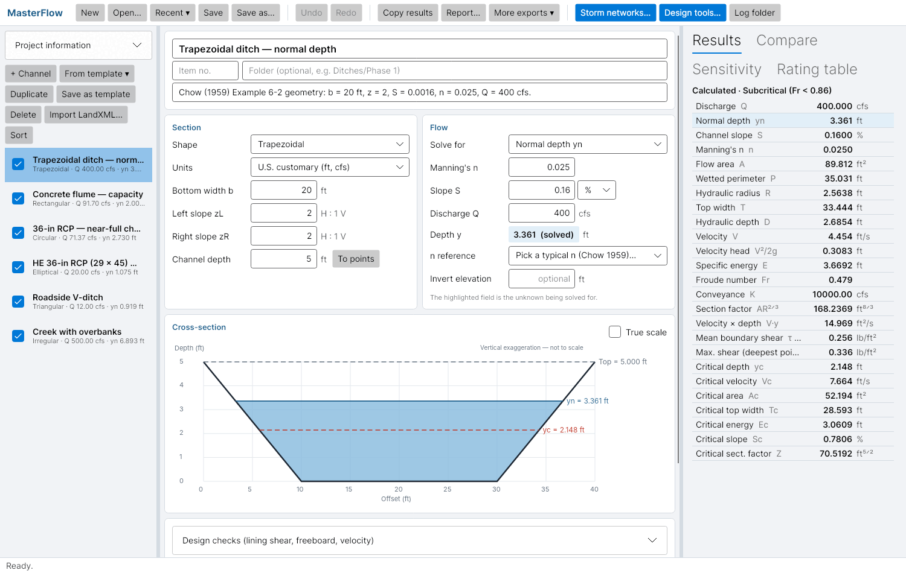

| Area | What it holds |
|---|---|
| Top toolbar | File commands (New, Open…, Recent ▾, Save, Save as…), Undo/Redo, Copy results, Report…, More exports ▾ (Batch report…, Compare report…, Excel workbook…), **Storm networks…** (Ctrl+Shift+N), **Design tools…** (Ctrl+Shift+D), Log folder |
| Left pane | Project information (shown on every report), the calculation list, + Channel, From template ▾, Duplicate, Save as template, Delete, Import LandXML…, Sort, and the recycle bin |
| Middle pane | Title, item number, folder and description; Section and Flow inputs; the cross-section drawing; Design checks |
| Right pane | Tabs: **Results**, **Compare**, **Sensitivity**, **Rating table**, and **Structures** after a pipe network import |
| Status bar | What MasterFlow just did, and any message that needs attention |

The two other windows are opened from the toolbar:

- **Storm networks…** for storm sewer HGL/EGL (Chapter 6).
- **Design tools…** for the 42 drainage design tools (Chapters 7 to 15).

## Projects and files

A project is one `.mfproj` file (readable JSON with a schema version). It holds the project information, every
channel and pipe calculation, the recycle bin, the storm networks, the last input of every design tool and the report
settings. Files written by a newer MasterFlow with a newer schema are refused rather than misread.

| Task | How |
|---|---|
| New, open, save | Ctrl+N, Ctrl+O, Ctrl+S, Ctrl+Shift+S (Save as) |
| Recent projects | **Recent ▾** |
| Undo / redo | Ctrl+Z / Ctrl+Y, per calculation |
| Open a project from Explorer | Double-click it. If MasterFlow is already open, that window comes forward and opens the project (after asking about unsaved changes) |

**Autosave and recovery.** Every minute, unsaved work is copied to a recovery file in your user folder, never over
your own project. If MasterFlow closes unexpectedly, the next start offers **Restore**, **Keep for later** (saved
under `%APPDATA%\MasterFlow\recovered`) or **Discard**.

**Log folder.** MasterFlow keeps a plain-text log of saves, exports and errors on your computer only, one file per day
for 14 days. **Log folder** opens it, for example to attach a file to a problem report.

| What | Where |
|---|---|
| Projects | Wherever you save them |
| Recent files, user templates, settings (license key), recovery copy | `%APPDATA%\MasterFlow` |
| Log | `%APPDATA%\MasterFlow\logs` |
| Atlas 14 cache | `%APPDATA%\MasterFlow\atlas14` |
| Public site data cache, document text cache | `%LOCALAPPDATA%\MasterFlow\site-data`, `…\memory-index` |

## Units

Each calculation and each storm network is in **U.S. customary** (ft, cfs; pipe sizes in inches) or **SI** (m,
m³/s; pipe sizes in mm). MasterFlow never converts behind your back: the engine computes in the units you enter, with
k = 1.486 and g = 32.174 ft/s² (U.S.) or k = 1 and g = 9.80665 m/s² (SI). Changing the unit system does not convert
numbers already entered. Most Rapid City design tools work in U.S. units only, because their equations and criteria
are empirical in feet, acres and inches; they say so with an error if run in an SI project.

# Free and Premium

MasterFlow Free covers single-element calculations, the storm network HGL/EGL solution and its reports, LandXML import,
and the design tools listed as free below. **MasterFlow Premium** adds the tools that automate design, combine many
calculations, or produce deliverables. Premium tools appear in the tool list with "★ Premium" after the name; premium
buttons in the Storm networks window carry a ★. Without a license that covers them they do not run, and they say which
feature they need (message E-LIC-001).

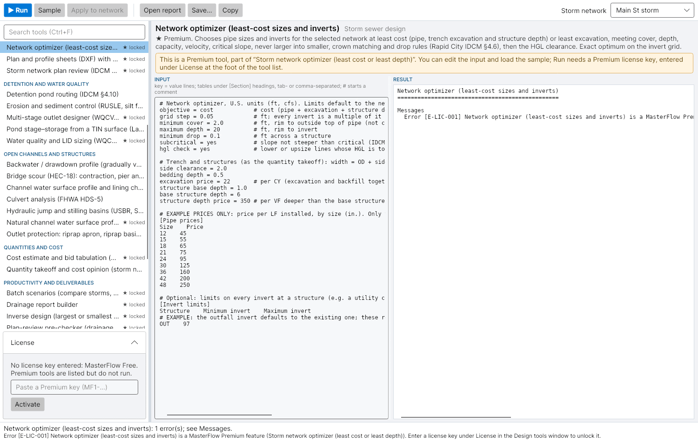

## Entering a license key

Open **Design tools…** and paste the key into the **License** box (spaces and line breaks are ignored), then press
**Activate**. The line beside the button shows the edition, the licensee and the expiry. A valid key is kept in your
user settings and checked again at each start. An empty box plus **Activate** returns to Free. A rejected key is not
saved and the previous license stays in force.

Keys are checked offline: `MF1-` followed by a signed payload (ECDSA P-256). The program holds only the public key, so
it can check a key with no network access but cannot make one. A key is not tied to a computer. It lists the features
it covers (`*` means every premium feature, present and future), an issue date and an optional last valid day.

## Feature list

| Area | Free | ★ Premium |
|---|---|---|
| Channels and pipes | All section shapes, solve for any unknown, design checks, rating tables, sensitivity, compare, PDF/HTML/Excel reports, templates | |
| Civil 3D | LandXML import of cross-sections, pipe networks and alignments | LandXML pipe network export; HGL/EGL write-back to Civil 3D (`civil3d-export`) |
| Storm networks | HGL/EGL solve, profiles, reports, Excel | Automatic pipe sizing (`pipe-sizing`) |
| Hydrology | Rational method, TR-55, Bulletin 17C flood frequency | NOAA Atlas 14 lookup, hydrograph network routing |
| Streets and inlets | Gutter spread and inlets, street capacity, sag ponding and clogging | Inlet capacity and bypass routing across a network |
| Storm sewer design | | Plan review (IDCM §4.6), network optimizer, plan and profile DXF, SWMM 5 exchange, dynamic-wave routing |
| Detention and quality | Detention routing, pond storage from a TIN, erosion and sediment control | Multi-stage outlet designer, water quality and LID sizing |
| Channels and structures | Backwater profile, channel profile and lining, culverts (HDS-5), outlet protection (HEC-14), stilling basins, bridge scour | Natural channel profiles (HEC-RAS method) |
| HEC/HDS manual tools | Riprap (HEC-11), linings (HEC-15), AOP culverts (HEC-26), scour countermeasures (HEC-23), bridge debris and forces (HEC-9, HDS-7), deck drainage (HEC-21), stream stability (HEC-20), sediment transport (HDS-6), flood risk (HEC-17), regional regression (HDS-2), pump stations (HEC-24), spillways and breach (TR-60), snowmelt, pond sediment, groundwater mounding, underdrains | |
| Sanitary sewers | Lift station and force main (`sanitary-lift-station`), sewer casings and trenchless crossings (`sewer-casing`), inverted siphons (`inverted-siphon`) | |
| Structures and storage | Manhole sizing, pipe structural design (RCP class, flexible deflection), structure flotation, roof drains and scuppers, trash racks, weirs and Parshall flumes, water quality flow splitter, slope-area peak discharge, preliminary detention storage, underground detention | |
| Cost | Quantity takeoff and opinion of probable cost | Cost estimate and bid tabulation |
| Productivity and deliverables | | Batch scenarios, inverse design, drainage report builder, what-changed diff, plan-review pre-checker, review comment tracker |
| Sanitary sewers | | Sanitary sewer network design (Rapid City IDCM §3.12): design flows, sizing, inverts, manholes, H2S (`sanitary-network`) |
| Land development | | Site feasibility, grading solver, utility conflicts, permit tracker, field-to-model, construction companion, climate stress test, institutional memory search |

Which tool belongs to which license feature is one list in the program (`PremiumFeatures.All`), so a tool can move
between Free and Premium without other changes.

# Channel and pipe calculations

A **calculation** is one cross-section at steady, uniform flow by Manning's equation. It is the free core of the
program and is the fastest way to check a ditch, a gutter, a pipe or a surveyed creek section.

## Section shapes

| Shape | Inputs | Notes |
|---|---|---|
| Rectangular | Bottom width b | |
| Trapezoidal | b; left and right side slopes zL, zR (H:1V) | |
| Triangular | zL, zR | V-ditches and gutters |
| Circular | Diameter (in. or mm) | Part-full flow; reports full-flow and maximum capacity |
| Elliptical | ASTM C507 standard size (HE or VE), or a custom rise and span | Standard sizes use the C507 four-centred shape; custom is a true ellipse (they differ by about 3 % in normal depth) |
| Irregular | Station/elevation points, optional n per point | Surveyed or LiDAR sections, streets, compound channels |

**Channel depth** (open shapes) is optional. When the water is above it, warning W-G-001 says the channel overtops;
the result is still computed as if the walls continued.

## Solve for

Pick the unknown in **Solve for**. Its field turns grey and shows the solved value.

| Solve for | You enter |
|---|---|
| Normal depth yn | n, slope, discharge |
| Discharge Q | n, slope, depth |
| Slope S | n, discharge, depth |
| Manning's n | slope, discharge, depth |

Slope is entered in **percent** by default (0.5 % = 0.005 ft/ft). The box beside it switches to **ft/ft** (m/m) and
converts the number typed. Because other programs read a typed "0.02" as 0.02 ft/ft, MasterFlow warns (W-S-003) when a
percent slope is below 0.05 % or a ft/ft slope is above 0.2, and gives both readings.

The **n reference** list offers typical values from Chow (1959) Table 5-6 (minimum, normal, maximum); picking one fills
in the normal value. **Invert elevation** (optional) adds water-surface, energy-grade and critical water-surface
elevations to the results.

## Irregular sections

Type or paste points, one per line: `station, elevation [, n [, description]]`. Separators can be tab (a paste from
Excel), semicolon, comma or spaces. Stations may use surveyor notation (`1+25.50` = 125.50; `1+250.000` = 1250 in
metric chainage). A first line that is not numeric is a header; lines starting with `#` are ignored. Every line that
cannot be read is listed with its line number. Up to 5000 points are accepted.

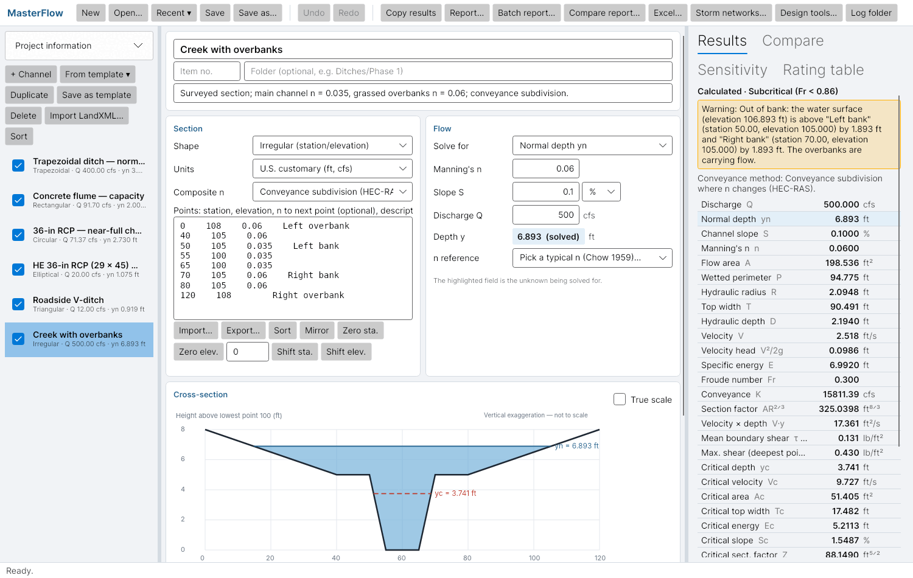

**n on a point applies to the segment from that point to the next.** A blank n uses the calculation's n.

**Composite n**, when n varies across the section:

- *Conveyance subdivision* (default, the HEC-RAS approach): the area is split at each change in n, the conveyance of each
  part is summed, and the report shows the flow, area and velocity of each part.
- *Equal velocity* (Horton–Einstein): one composite n for the wetted perimeter.
- *Per-segment conveyance*: every segment is its own part, whether or not n changes. It gives more conveyance in wide, shallow overbanks.

Awkward sections are handled and reported, not hidden:

| Situation | What happens | Message |
|---|---|---|
| Water above an end point | A vertical wall is added there (counted in wetted perimeter); freeboard is shown as a negative number | W-I-003 |
| Water above a point labelled as a bank ("Left bank", "TOB", "LB", "RB") | Out-of-bank warning with the depth above the bank | W-I-005 |
| Separate pools below the water surface | All of them carry flow | W-I-002 |
| Several depths carry the same Q | All are listed; the highest is reported | W-I-001 |
| Several specific-energy minima | All are listed; the lowest energy is critical | W-I-004 |
| Solve for n with n on points | Not possible | E-N-002 |

**Point tools** under the points box (each one is an undo step): Import… (text or CSV), Export… (CSV), Sort, Mirror,
Zero sta., Zero elev., Shift sta., Shift elev. **To points** converts a rectangular, trapezoidal or triangular channel
into the same section as points so it can be edited like a surveyed one.

## Pipes

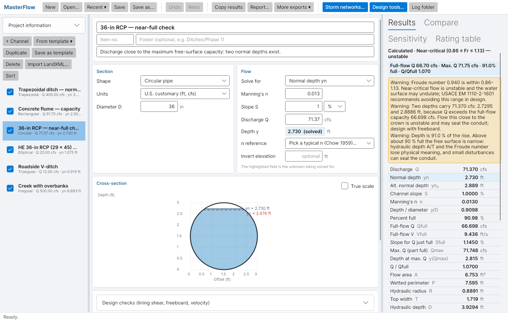

- **Circular:** above about 94 % full the same Q can occur at two depths; the lower one is reported and the upper one is
  listed (W-P-001). A discharge above the maximum free-surface capacity is an error (E-P-001), never an invented depth.
- **Elliptical:** tick *ASTM C507 standard size* and pick a size (tick *Vertical (VE)* for vertical ellipses), or untick
  it and enter rise and span for a true ellipse.
- Pipe drawings are always to true scale.

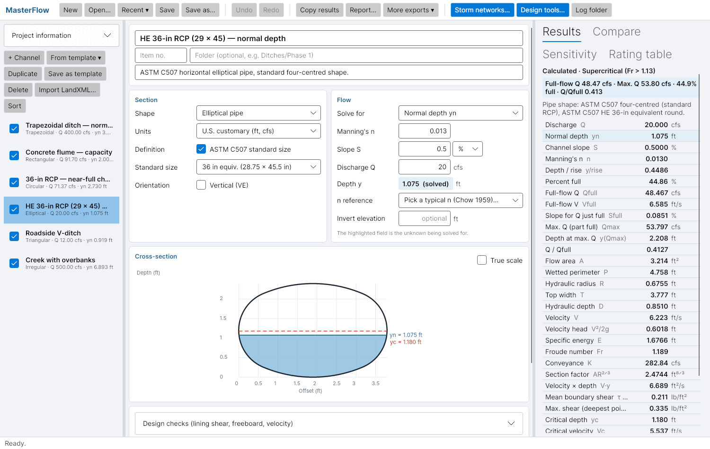

## Title, folder and item number

**Item no.** is a free drawing or item number shown in the list and report header. **Folder** organises the list
(`Ditches/Phase 1`); **Sort** orders by folder then title in natural order. A title can hold live values in braces
that update as inputs change, for example `{shape} — {D} in pipe, Q = {Q:F1} {Qunit}` gives
"Circular — 36 in pipe, Q = 71.4 cfs". Fields: `{shape} {units} {folder} {Q} {Qunit} {yn} {yc} {unit} {S} {n} {V} {Fr}
{regime} {A} {T} {b} {zL} {zR} {D} {rise} {span} {WSE} {pctfull} {item}`, with an optional .NET number format after a
colon. A misspelt field shows as `{?name}`.

## Results and messages

The **Results** tab lists every quantity with its symbol and unit; solved values are bold. Groups: governing values;
normal flow (area, wetted perimeter, hydraulic radius, top width, hydraulic depth, velocity, velocity head, specific
energy, Froude number, conveyance, section factor, V·y, mean and maximum boundary shear); critical flow at the same
discharge (yc, Vc, Ac, Tc, Ec, critical slope, critical section factor); elevations when an invert is known; and, for
irregular sections, the composite n, the energy coefficient α and the number of wetted areas.

Messages carry a code: **E** errors (no result is shown), **W** warnings, **I** information. Warnings are repeated in a
yellow box at the top of the Results tab. Examples: W-N-001 (n outside 0.008–0.20), W-S-001 (slope above 10 %),
W-F-001 (near-critical flow, 0.86 ≤ Fr ≤ 1.13). If a calculation cannot be solved MasterFlow shows the error and **no
numbers**; it never reports a value from a solver that did not converge.

**Copy results** puts the results on the clipboard as tab-separated text for Excel.

## Design checks

Open **Design checks** under the inputs and enter any of: a lining description, the permissible shear τp for that
lining (HEC-15 or your agency's manual), a required freeboard, and a minimum or maximum velocity. Blank limits are
skipped. Each check is listed with the computed value, the limit and **OK**, **FAILS** or **Not evaluated**; failures
are also warnings (W-C-001 to W-C-004) and are printed in reports and Excel.

- Shear: τd = γ·yn·S, the shear at the deepest point of a straight channel (HEC-15 Eq. 2.3). Bends are not included.
- Freeboard needs a channel depth on regular shapes; irregular sections use the lower end point.
- Pipes: shear and freeboard are not evaluated; velocity limits are.

## Rating tables

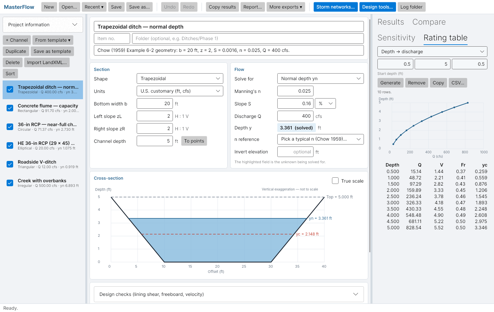

Choose **Depth → discharge** or **Discharge → depth**, the start, end and step, then **Generate** (up to 5000 rows).
**Copy** and **CSV…** export it. A generated table is saved with the calculation and rebuilt from the current inputs in
its report and Excel sheet; **Remove** stops including it.

## Sensitivity to n and slope

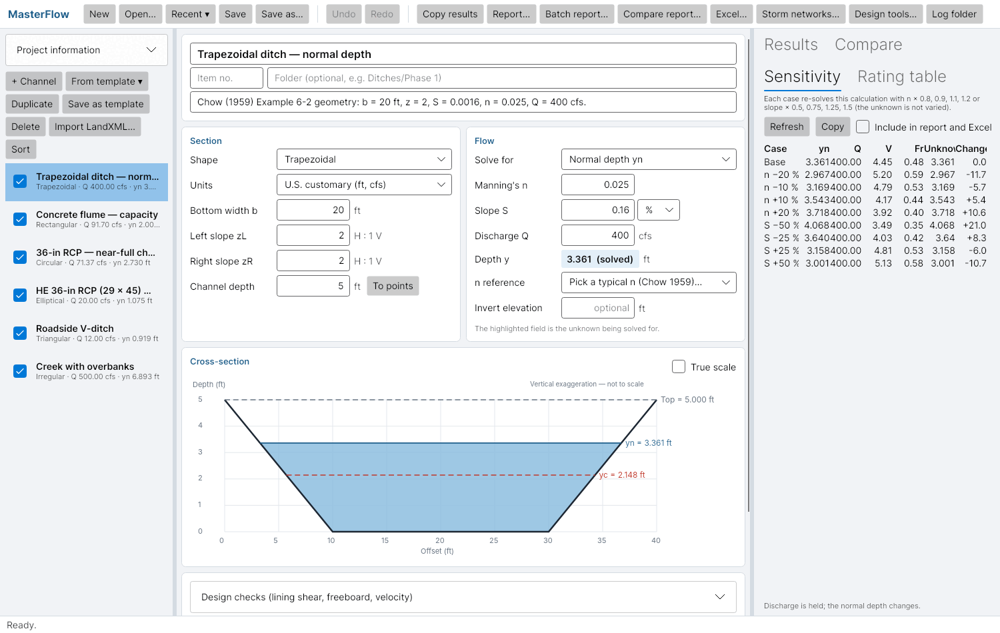

The **Sensitivity** tab re-solves the selected calculation with n multiplied by 0.8, 0.9, 1.1 and 1.2 and with the
slope multiplied by 0.5, 0.75, 1.25 and 1.5, keeping the same unknown. Each row shows yn, Q, V, Fr, the regime and the
change from the base case. Tick **Include in report and Excel** to print it. Hand check: at a fixed depth Q ∝ √S / n, so
n + 10 % gives Q − 9.1 % and slope − 50 % gives Q − 29.3 %.

## Comparing alternatives

Every calculation has a tick box. Ticked, solved calculations appear side by side on the **Compare** tab and in the
**Batch report**, **Compare report** and **Excel** workbook. Calculations in different unit systems are not converted;
the comparison says so.

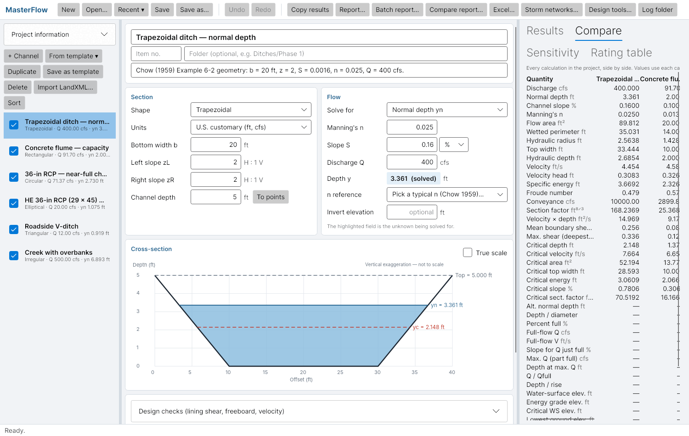

## Reports and exports

| Button | Output |
|---|---|
| **Report…** (Ctrl+E) | The selected calculation |
| **More exports ▾ → Batch report…** | Every ticked calculation, each on a new page |
| **More exports ▾ → Compare report…** | The side-by-side comparison, landscape |
| **More exports ▾ → Excel workbook…** | Workbook: comparison sheet, one sheet per ticked calculation, rating tables |

Reports are PDF by default; choose *HTML report* in the save dialog for an HTML file. They contain the project
information, method, inputs, cross-section, results, warnings and assumptions, rating table, sensitivity table,
notes and (optionally) the full calculation trace. **Project information** holds the report settings: watermark (for
example PRELIMINARY), footer text, company **Logo…** (PNG, JPEG, GIF or SVG up to 1 MB; SVG shows in HTML only) and
**Include calculation trace in reports**. Excel numbers are stored at full precision.

## Templates

**From template ▾** offers built-in generic starting points (street half-section, full street, V-ditch, grass swale,
concrete trapezoid, flume, RCP, CMP, HE pipe, natural channel) and your own. Their dimensions are generic; edit them
to the governing standard detail. **Save as template** keeps the selected calculation as a template for your Windows
user, available in every project.

## Method in brief

Q = (k/n)·A·R^(2/3)·S^(1/2), R = A/P. Critical depth satisfies Q²T/(gA³) = 1; Fr = V/√(gD), D = A/T. Unknown depths are
found with Brent's bracketed method, with a relative depth tolerance of 1×10⁻¹² and a discharge residual of at most
1×10⁻⁸. Assumptions for open channels: prismatic channel, small slope, hydrostatic pressure, α = 1 for regular shapes.
Assumptions for circular and elliptical pipes: steady, uniform gravity flow, partly full with a free water surface, n
uniform around the perimeter and constant with depth; surcharge, HGL and structure losses belong in a storm network.
Each report prints the note for its element type. Validation against
hand calculations and published examples is in `docs/HYDRAULIC_METHODS.md` and `docs/VALIDATION_RESULTS.md`.

# Civil 3D and LandXML

## Importing

**Import LandXML…** in the project pane reads files exported from Civil 3D (or any program that writes LandXML 1.x).
Values are used exactly as written; the unit system comes from the file, and if the file does not state feet or
metres the status bar says so. Anything that cannot be read is listed, never guessed.

- **Cross-sections** (sample lines): each section and surface becomes an irregular calculation titled like
  `Ditch A 12+34.50 (EG)` in a folder named after the alignment. n is set to 0.035; set n, slope and discharge.
- **Pipe networks:** each circular or elliptical pipe becomes a pipe calculation `P-1 (CB-1 → MH-1)` in
  `<network>/Pipes`, solving for the full-flow capacity (enter the design Q and switch to normal depth to check it).
  The network itself is set up in the Storm networks window with pipes, sizes, lengths, inverts, structures and rims.
  Inlets, manholes and outlets appear on the **Structures** tab and in a *Structures* Excel sheet. Importing the same
  network again updates them.
- **Alignments** in the file (or a separate alignment export) station the structures: each structure gets the nearest
  alignment's name, station (`12+34.56`) and offset (positive right). Lines, curves and clothoid spirals are read.
- Reported, not fixed: missing inverts, flat or adverse pipes, other pipe shapes, and sizes that look like inches in a
  feet file.

Exporting back to Civil 3D (LandXML pipe network and HGL write-back) is described with the Storm networks window in
§6.5 and §6.6.

# Storm networks: HGL and EGL

**Storm networks…** opens the window for storm sewer hydraulic grade lines. It is free, except the three ★ buttons.

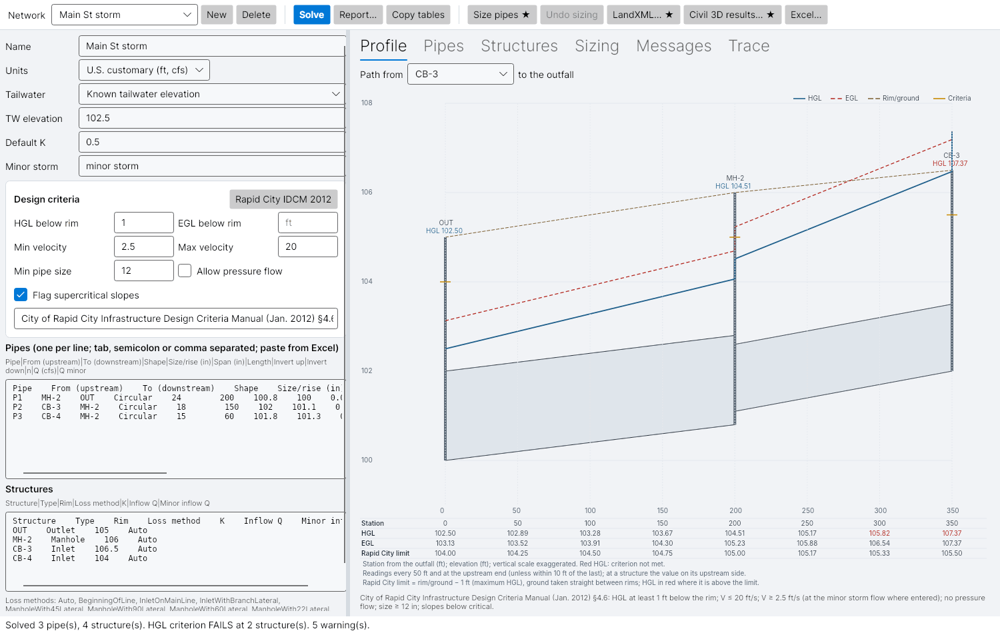

## Entering a network

1. **New** adds an empty network, or **Import LandXML…** in the main window builds one from a Civil 3D pipe network.
2. **Pipes**, one per line: *Pipe, From (upstream structure), To (downstream structure), Shape, Size or rise (in. or
   mm), Span (elliptical only), Length, Invert up, Invert down, n, Q*, and optionally *Q minor*. Leave Q blank to have
   it accumulated from the structure inflows (a pipe carries the inflow at its upstream structure plus every pipe
   entering that structure); a typed Q overrides this and is carried downstream. Accumulated values are marked Σ. A
   range copied from Excel pastes straight in.
3. **Structures**: *Structure, Type, Rim, Loss method, K, Inflow Q, Minor inflow Q*. A blank loss method is *Auto*.
   Methods: the IDCM Figure 4-6/4-7 cases (beginning of line, inlet on main line, inlet with branch lateral, manholes
   with 22.5°, 45°, 60° and 90° laterals, and so on), bends, or StandardK with a K.
4. **Tailwater**: known elevation, free outfall, crown, or (yc + D)/2.
5. **Design criteria**: type values, or press **Rapid City IDCM 2012**: HGL at least 1 ft below the rim, 2.5 to 20 ft/s
   (minimum at the minor-storm flow), 12 in. minimum size, slopes below critical, no pressure flow. *EGL below rim* is
   optional.
6. **Solve** (F5). The status bar says whether the HGL criterion is met everywhere.

## Method

The energy equation is integrated upstream from each outfall by the standard step,
z₁ + y₁ + V₁²/2g = z₂ + y₂ + V₂²/2g + S̄f·Δx with Sf = (Qn/(kAR^⅔))². Above the crown the full-pipe area and perimeter
are used (pressure flow). The depth at a pipe outlet is not taken below critical. Steep pipes with no subcritical
solution are computed supercritical from critical depth at the entrance, and a hydraulic jump is placed where the
momentum functions are equal. At each structure the HGL rises by the structure loss: IDCM Figures 4-6/4-7,
hj = V₂²/2g − c·V₁²/2g (beginning of line 1.25·V₂²/2g), or IDCM Eq. 4-6-1 hs = K·Vo²/2g; V₂ is the outlet pipe velocity
and V₁ that of the largest inflow (the pipe with the largest flow sets V₁ at a multi-inflow structure). The structure
water level is the starting water surface for every inflow pipe.

## Results

| Tab | Content |
|---|---|
| **Profile** | Choose the path to the outfall. HGL solid, EGL dashed, rim/ground dashed brown, the criterion as an orange tick at each structure; a red HGL label fails. Under the graph, a reading band lists station, HGL, EGL and the Rapid City limit (rim/ground − 1 ft) every 50 ft (15 m in SI), with the HGL in red where it is above the limit |
| **Pipes** | Q (Σ = accumulated), size, slope, capacity, velocities, depths, HGL and EGL at each end, regime, flow condition |
| **Structures** | Rim, HGL, EGL, loss, rim − HGL and the check; failing rows shaded red |
| **Sizing** | Changes made by Size pipes ★ |
| **Messages**, **Trace** | Warnings by code, and the solver's step-by-step record |

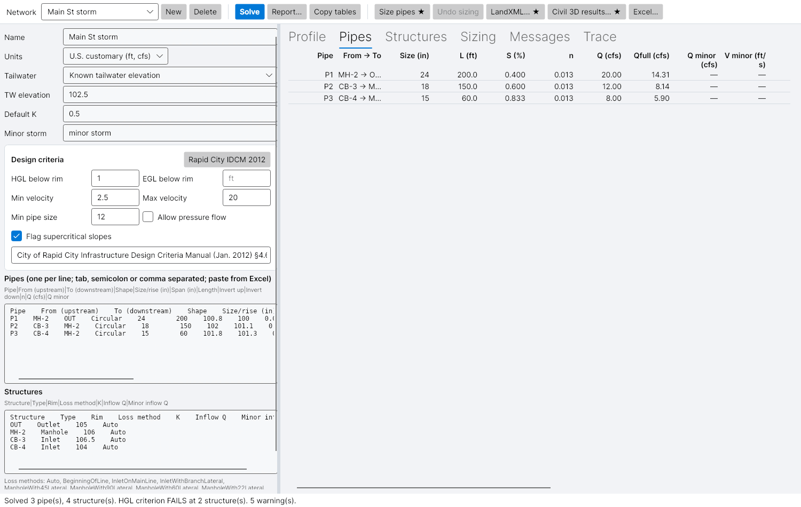

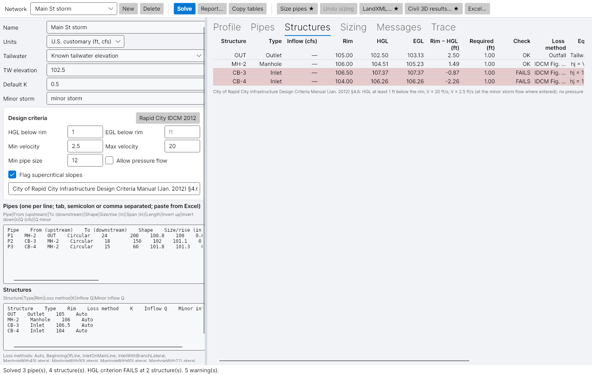

**Report…** saves a PDF (or HTML) with a profile per path and both tables; **Copy tables** puts them on the clipboard;
**Excel…** adds sheets for pipes, structures, the 50-ft readings (with limit − HGL and OK/FAILS), every profile point and
messages. Networks are saved with the project.

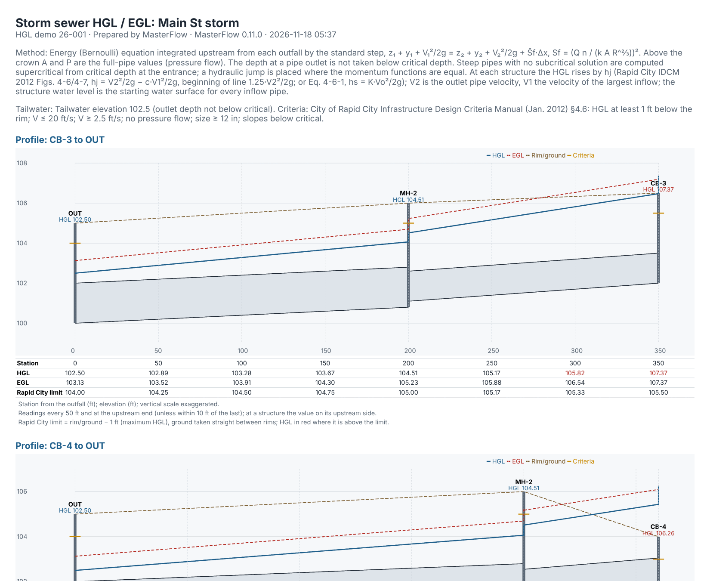

## Size pipes ★ Premium

Picks circular sizes: the smallest standard size (12 to 108 in., or 300 to 3000 mm) that carries the design Q part full
(unless pressure flow is allowed) within the velocity limits and is never smaller than a pipe upstream. Then, wherever a
structure's HGL is too close to its rim or a pipe still flows full, it tries one size up on each pipe between that
structure and the outfall and keeps the change that lowers the water level most, repeating until the criteria are met or
nothing more helps. Inverts, n, lengths and elliptical pipes are kept, and no crown is put above a rim. Every change, and
anything it could not fix, is listed on the **Sizing** tab; **Undo sizing** restores the previous sizes.

## LandXML… export ★ Premium

Writes the network as a LandXML 1.2 pipe network that validates against the published schema: units, sizes, lengths,
slopes, n, inverts, rims, sumps, coordinates and structure types. A solved network adds *PipeFlow* (Q, HGL up/down,
critical depth) and *StructFlow* (HGL in and out, structure loss) and a "MasterFlow hydraulics" feature on every part
with EGL, velocities, depths, Q full, regime, friction loss and *Check* (OK or the warning codes the part fails). In
Civil 3D use *Insert → LandXML* with a parts list that has the sizes.

## Civil 3D results… ★ Premium

Puts the results on the network already in your drawing. It saves *name HGL.lsp* and *name HGL.csv*. In Civil 3D run
*APPLOAD* on the .lsp, then **MFHGL**: every pipe in the network of the same name whose name matches gets HGL up, HGL
down, EGL up, EGL down and flow rate, so labels, profile-view HGL lines and pipe tables show MasterFlow's values. The
whole run is one undo. Structure results (HGL, EGL, loss, rim − HGL, check) are in the CSV. See
`docs/CIVIL3D_ROUNDTRIP.md` for the steps still to be confirmed in Civil 3D.

# The Design tools window

**Design tools…** (Ctrl+Shift+D) opens one window for every drainage design tool. All 42 tools work the same way.

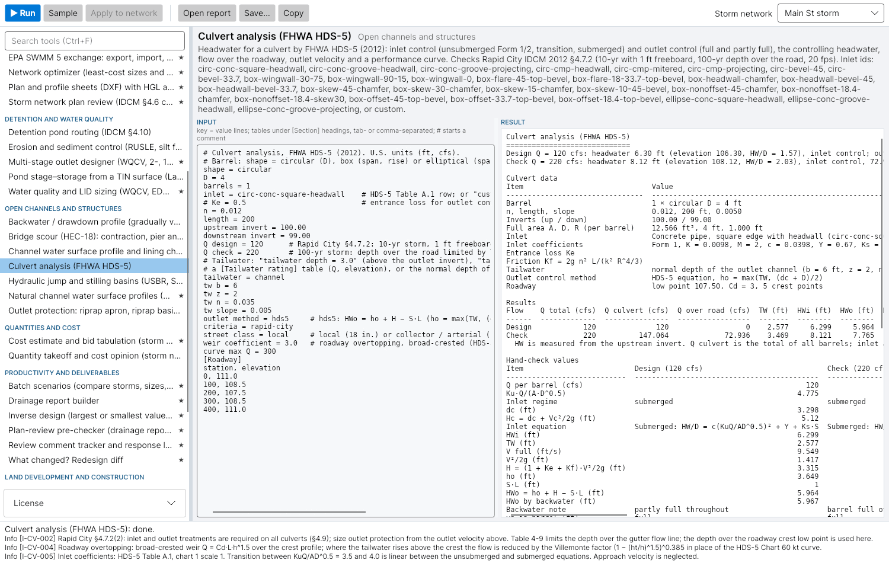

1. **Pick a tool from the list on the left.** Tools are grouped by subject, in the same order as chapters 8 to 15 of
   this manual. A Premium tool shows ★, or "★ locked" when your license does not cover it. Type in the search box
   (Ctrl+F) to filter by name, description or subject. Enter picks the best match and Esc clears the search. The
   heading above the input shows the tool's name, its subject and what it does.
2. **Storm network** (top right) is the network that network-aware tools read or write.
3. **Sample** fills in a worked example, using the selected network's structure names where it can. If you have
   edited the input, MasterFlow asks before replacing it. Every sample runs without errors, and the test suite runs
   them all.
4. **Edit the input.** It is made of `key = value` lines, then tables under `[Section]` headings. Tables are tab- or
   comma-separated, the first line of a table is its header, and `#` starts a comment. Columns are usually found by
   their header, so their order is free. The sample comments state the lengths, flows and units.
5. **▶ Run** (F5 or Ctrl+Enter). The result appears as aligned text, and every error, warning and assumption is
   listed under Messages. A part that cannot be computed is reported, never estimated. If you change the input after
   a run, an amber banner warns that the result on screen no longer matches it until you run again.
6. **Use the result:**
   - **Open report** shows the full report, with its charts and figures, in your browser without asking for a file
     name.
   - **Save…** writes an HTML report, a PDF report or an Excel workbook. Some tools also offer Word, DXF or SWMM .inp.
   - **Copy** puts the text on the clipboard, followed by the tables tab-separated for Excel.
   - **Apply to network** appears where the tool offers it. Nothing changes in the network until you press it; it
     writes the result and re-solves the network.

**License** at the foot of the tool list holds the Premium key box (chapter 3). It opens by itself when you select a
locked tool, and a banner over the input explains what the tool needs.

The last input of each tool is saved with the project, so a project re-runs exactly. The drainage report builder,
the pre-checker, the redesign diff and inverse design all re-run those saved inputs.

## Tools at a glance

| Chapter | Tool | Tool id | License |
|---|---|---|---|
| 8 Hydrology | Rational method (Rapid City IDCM §4.2) | `rational-rapid-city` | Free |
| | NOAA Atlas 14 rainfall (IDF lookup) | `atlas14-idf` | ★ Premium |
| | TR-55 hydrology | `tr55-hydrology` | Free |
| | Hydrograph network routing | `hydrograph-routing` | ★ Premium |
| | Flood frequency (Bulletin 17C) | `flood-frequency` | Free |
| | Regional regression peak flows (HDS-2, USGS) | `regional-regression` | Free |
| | Snowmelt and rain-on-snow | `snowmelt` | Free |
| | Slope-area peak discharge from high-water marks | `slope-area` | Free |
| 9 Streets and inlets | Gutter spread and inlets | `gutter-inlets` | Free |
| | Street capacity and gutter spread | `street-capacity` | Free |
| | Inlet capacity and bypass routing | `inlet-network` | ★ Premium |
| | Sag inlet ponding and clogging | `sag-ponding` | Free |
| | Bridge deck drainage (HEC-21) | `deck-drainage` | Free |
| | Pavement edge drains and permeable base | `pavement-edge-drain` | Free |
| | Roof drains, leaders and scuppers | `roof-drainage` | Free |
| 10 Storm sewer design | Storm network plan review (IDCM §4.6) | `network-plan-review` | ★ Premium |
| | Network optimizer | `network-optimizer` | ★ Premium |
| | Plan and profile sheets (DXF) | `plan-profile-dxf` | ★ Premium |
| | EPA SWMM 5 exchange | `swmm-exchange` | ★ Premium |
| | Dynamic-wave storm sewer routing | `dynamic-wave` | ★ Premium |
| | Stormwater pump stations (HEC-24) | `pump-station` | Free |
| | Manhole and structure size from pipes | `manhole-sizing` | Free |
| | Pipe structural design (RCP class, flexible deflection) | `pipe-structural` | Free |
| | Structure buoyancy (flotation) | `structure-buoyancy` | Free |
| 11 Detention and water quality | Detention pond routing | `detention-routing` | Free |
| | Pond stage–storage from a TIN | `pond-storage` | Free |
| | Multi-stage outlet designer | `outlet-designer` | ★ Premium |
| | Water quality and LID sizing | `water-quality` | ★ Premium |
| | Erosion and sediment control | `erosion-sediment` | Free |
| | Pond sediment and clean-out interval | `pond-sediment` | Free |
| | Groundwater mounding (Hantush) | `groundwater-mounding` | Free |
| | Bioretention underdrain | `bioretention-underdrain` | Free |
| | Emergency spillways and dam breach (TR-60) | `spillway-breach` | Free |
| | Trash rack head loss and clogging | `trash-rack` | Free |
| | Water quality flow splitter | `flow-splitter` | Free |
| | Preliminary detention storage estimate | `storage-estimate` | Free |
| | Underground detention: chambers or pipe gallery | `underground-detention` | Free |
| 12 Open channels and structures | Backwater / drawdown profile | `backwater-profile` | Free |
| | Channel water surface profile and lining checks | `channel-profile` | Free |
| | Natural channel profiles (HEC-RAS method) | `river-profile` | ★ Premium |
| | Culvert analysis (FHWA HDS-5) | `hds5-culvert` | Free |
| | Outlet protection (HEC-14) | `outlet-protection` | Free |
| | Hydraulic jump and stilling basins | `stilling-basin` | Free |
| | Bridge scour (HEC-18) | `bridge-scour` | Free |
| | Riprap revetment (HEC-11) | `riprap-revetment` | Free |
| | Channel and swale linings (HEC-15) | `channel-lining` | Free |
| | Culverts for aquatic organism passage (HEC-26) | `aop-culvert` | Free |
| | Bridge scour countermeasures (HEC-23) | `scour-countermeasures` | Free |
| | Bridge debris and hydraulic forces (HEC-9, HDS-7) | `bridge-debris-forces` | Free |
| | Stream stability (HEC-20) | `stream-stability` | Free |
| | Sediment transport (HDS-6) | `sediment-transport` | Free |
| | Flood risk and least total expected cost (HEC-17) | `floodplain-risk` | Free |
| | Flow measurement: weirs and Parshall flumes | `flow-measurement` | Free |
| 13 Quantities and cost | Quantity takeoff and cost opinion | `quantity-takeoff` | Free |
| | Cost estimate and bid tabulation | `cost-estimate` | ★ Premium |
| 14 Productivity and deliverables | Batch scenarios | `batch-scenarios` | ★ Premium |
| | Inverse design | `inverse-design` | ★ Premium |
| | Drainage report builder | `drainage-report` | ★ Premium |
| | What changed? Redesign diff | `redesign-diff` | ★ Premium |
| | Plan-review pre-checker | `submittal-precheck` | ★ Premium |
| | Review comment tracker and response letter | `review-comments` | ★ Premium |
| 15 Land development and construction | Site feasibility | `site-feasibility` | ★ Premium |
| | Grading solver | `grading-solver` | ★ Premium |
| | Utility conflict finder | `utility-conflicts` | ★ Premium |
| | Permit and approval tracker | `permit-tracker` | ★ Premium |
| | Field-to-model (as-built and HGL certification) | `field-to-model` | ★ Premium |
| | Construction-phase companion | `construction-companion` | ★ Premium |
| | Climate stress test | `climate-stress` | ★ Premium |
| | Institutional memory search | `memory-search` | ★ Premium |
| 16 Sanitary sewers | Sanitary sewer network design | `sanitary-network` | ★ Premium |
| 16 Sanitary sewers | Inverted siphon | `inverted-siphon` | Free |
| 16 Sanitary sewers | Sanitary lift station and force main | `sanitary-lift-station` | Free |

The tool id is what the drainage report (`@tool <id>`), batch scenarios (`tool = <id>`) and inverse design refer to.

# Hydrology

## Rational method (Rapid City IDCM §4.2)

Free · `rational-rapid-city` · U.S. units

Peak runoff for each sub-basin for the 2-, 10- and 100-year storms of IDCM Table 4-2, routed through the storm network.

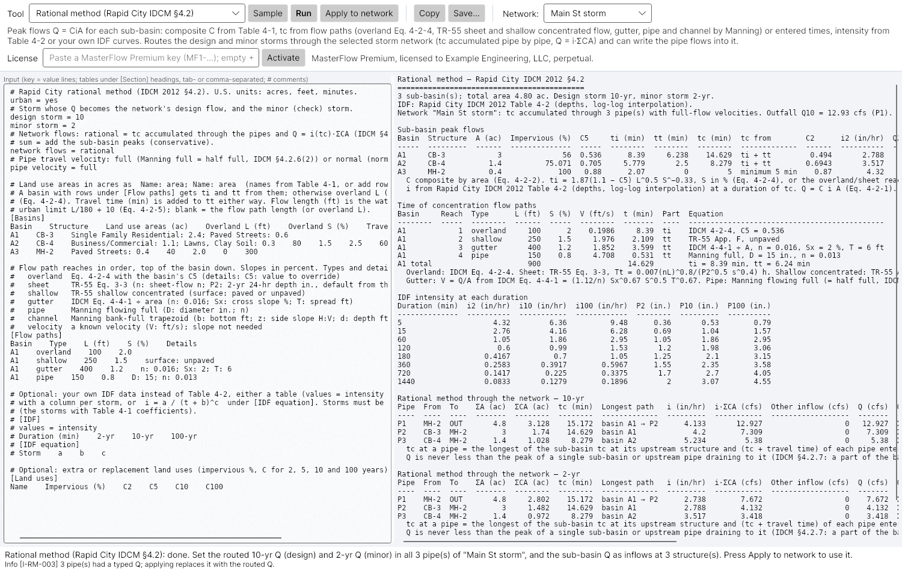

**Input.** `urban`, `design storm` (default 10), `minor storm` (default 2), `network flows` (`rational` or `sum`),
`pipe velocity` (`full` or `normal`). `[Basins]`: Basin, Structure, Land use areas (`Name: area; Name: area` with names
from Table 4-1 or your own `[Land uses]`), Overland L and S, Travel time, Flow length. `[Flow paths]`: one row per reach,
top down, of type `overland`, `sheet`, `shallow`, `gutter`, `pipe`, `channel` or `velocity`. Optional `[IDF]` table or
`[IDF equation]` (i = a/(t + b)^c) in place of Table 4-2.

**Method.**

| Step | Equation |
|---|---|
| Composite C | IDCM Eq. 4-2-2, C = ΣCᵢAᵢ/Aₜ, Table 4-1 per storm |
| Overland time | Eq. 4-2-4, tᵢ = 1.87(1.1 − C₅)L^0.5 S^−0.33 (L ft, S %) |
| Sheet flow | TR-55 Eq. 3-3, Tt = 0.007(nL)^0.8/(P₂^0.5 s^0.4) |
| Shallow concentrated | TR-55, V = 16.1345√s unpaved, 20.3282√s paved |
| Gutter | V = Q/A from IDCM Eq. 4-4-1 |
| Pipe, channel | Manning full (IDCM §4.2.6(2)), bank-full trapezoid (§4.2.6(3)) |
| Time of concentration | Eq. 4-2-3, t_c = tᵢ + t_t; urban limit Eq. 4-2-5, t_c ≤ L/180 + 10; minimum 5 min urban, 10 min rural |
| Intensity | Table 4-2 depth at t_c ÷ t_c, log–log interpolation of depth between tabulated durations |
| Peak | Eq. 4-2-1, Q = CiA |
| Network | For each pipe: ΣCA upstream, t_c = longest of the sub-basin t_c and (t_c + travel time) of each incoming pipe (IDCM §4.2.7), Q = i(t_c)·ΣCA plus other inflow; never less than the peak of any single sub-basin or incoming pipe (D-059) |

**Output.** Basin table (C per storm, tᵢ, t_t, t_c, i, Q), flow path table, network routing table, and the IDF curves
with each sub-basin's t_c marked. Basins over 160 ac are flagged (§4.2.2(3)). **Apply to network** writes the design and
minor storm flows into every pipe and the sub-basin flows as structure inflows.

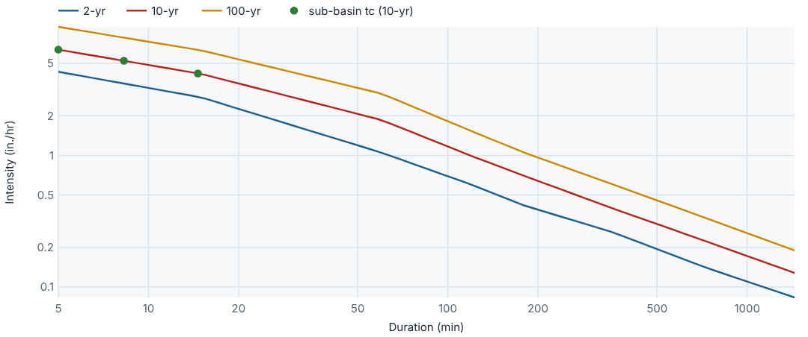

## NOAA Atlas 14 rainfall (IDF lookup) ★ Premium

`atlas14-idf`

Gets the NOAA Atlas 14 point precipitation-frequency table for a location and turns it into depth and intensity tables,
IDF curves, a comparison with IDCM Table 4-2, and input lines that other tools accept.

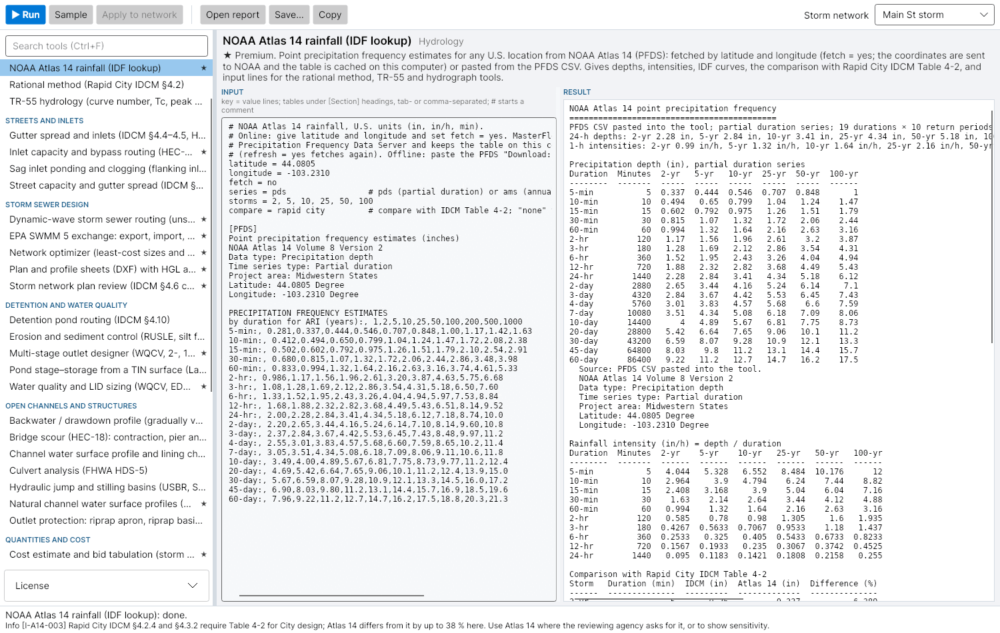

**Input.** Online: `latitude`, `longitude`, `fetch = yes` (and `series = pds|ams`, `refresh = yes`). Only the
coordinates are sent to NOAA's PFDS; the answer is cached under `%APPDATA%\MasterFlow\atlas14`. Offline: paste the PFDS
**Download: CSV** text under `[PFDS]`. `storms`, `compare = none` to skip the Table 4-2 comparison.

**Output.** Depths for every PFDS duration (5 min to 60 days), intensities (5 min to 24 h), the 90 % confidence interval
when present, log–log IDF curves, the comparison with Table 4-2 (2-, 10- and 100-yr) with percent difference, and ready-to-paste
lines: an `[IDF]` block for the rational method and `P2 = …` lines for TR-55 and hydrograph routing. Interpolation
between durations is linear in log depth against log duration.

**Rapid City note.** The IDCM bases City design on Table 4-2 (NOAA 1977 data). At Rapid City, Atlas 14 is up to 38 %
higher for the 100-yr storm at 3–24 h and about 12 % lower for the 10-yr 1-h depth. The tool reports the differences
and does not change which table governs.

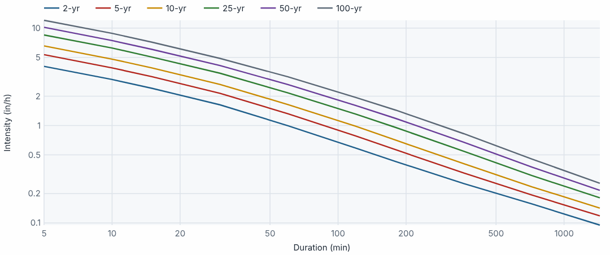

## TR-55 hydrology

Free · `tr55-hydrology` · U.S. units

Fills in the four TR-55 worksheets for one or more basins and draws each basin's runoff hydrograph. Source: USDA NRCS
*Urban Hydrology for Small Watersheds*, TR-55 (2nd ed., 1986); NEH Part 630 Ch. 16.

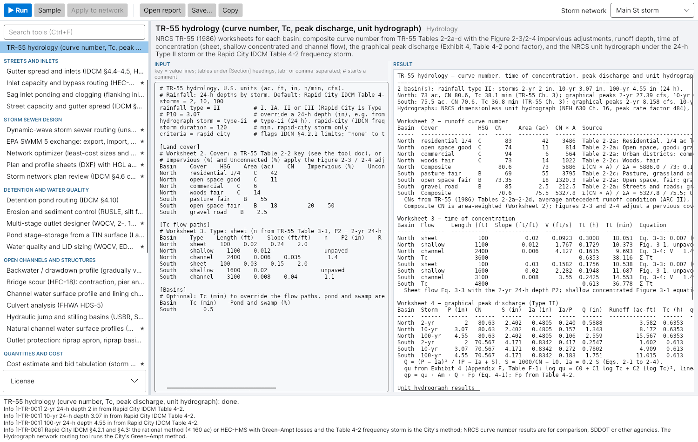

**Input.** `P<year> =` 24-h depths (default Table 4-2: 2-yr 2.00, 10-yr 3.07, 100-yr 4.55 in.), `rainfall type`
(I, IA, II, III), `hydrograph storm` (`type-ii`, `rapid-city`, `none`), `criteria`. `[Land cover]`: Basin, cover key and
HSG (or a CN), area, `Impervious (%)` and `Unconnected (%)`. `[Basins]` with Tc or `[Tc flow paths]` (sheet, shallow,
channel), and pond and swamp percentage.

**Method.** CN from Tables 2-2a–2-2d, area weighted (ARC II), with the Fig. 2-3/2-4 impervious adjustments; runoff
Q = (P − Ia)²/(P − Ia + S), Ia = 0.2S; Tc by Worksheet 3 (sheet flow warned over 100 ft, refused over 300 ft); graphical
peak qp = qu·Am·Q·Fp with qu from Appendix F Table F-1 coefficients; pond and swamp factor from Table 4-2; NRCS
dimensionless unit hydrograph (PRF 484, lag 0.6 Tc) convolved with the CN excess.

**Rapid City note.** IDCM §4.2.1 allows the rational method up to 160 ac and otherwise requires HEC-HMS with
Green–Ampt losses (§4.3.3). Curve-number results are for comparison, SDDOT or county work, or a reviewer's check; basins
over 160 ac are flagged (I-TR-005). For the City's method use Hydrograph network routing (Green–Ampt).

**Validation.** TR-55 Example 4-1 (qp 344 cfs vs. 345 in TR-55), Example 3-1 Tc (1.53 h) and Example 2-2 CN (75.2) are
reproduced.

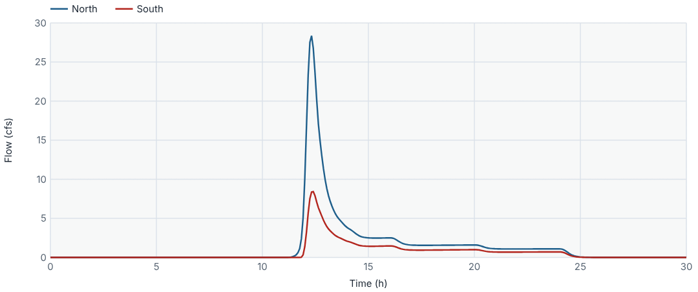

## Hydrograph network routing ★ Premium

`hydrograph-routing` · U.S. units

Runoff hydrographs for every sub-basin, combined at nodes as they arrive, and routed through pipes, channels and
ponds.

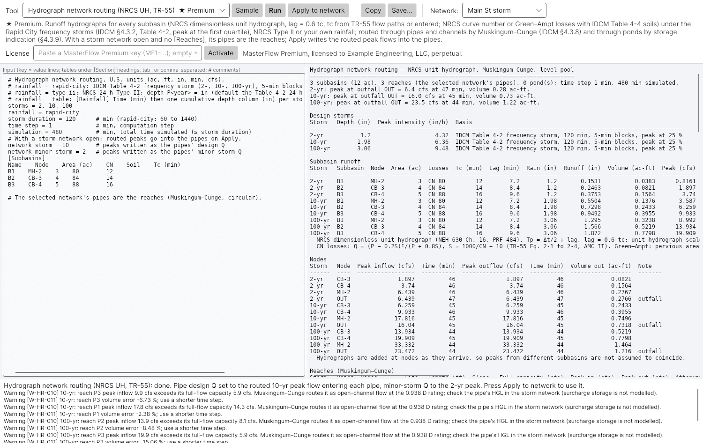

| Step | Method |
|---|---|
| Design storm | `rapid-city` (default): IDCM §4.3.2 frequency storm from Table 4-2, 5-min blocks peaking at the first quartile, `storm duration` 60–1440 min (default 120); `type-ii` NRCS 24-h; or `table` of cumulative depths |
| Losses | Curve number (TR-55 Eqs. 2-1 to 2-4) or Green–Ampt per IDCM §4.3.3–4.3.6: Ks and suction by soil class from Rawls et al. (1983) by default, or from IDCM Table 4-4 with `soil table = idcm` (the two differ only for loam and silt loam, and the report shows both values there, I-HR-014); deficit 0.20, Ia from Table 4-3, EIA = 0.1·MIA^1.5 (Eq. 4-3-1) |
| Tc | Entered Tc or lag, or TR-55 Chapter 3 flow paths |
| Transform | NRCS dimensionless unit hydrograph (NEH 630 Ch. 16), PRF 484, lag = 0.6 Tc |
| Reaches | Variable-parameter Muskingum–Cunge (IDCM §4.3.8, Ponce and Theurer 1982). With a network selected and no `[Reaches]`, the network's pipes are the reaches. A pipe whose peak exceeds full capacity is flagged OVER CAPACITY |
| Ponds | Storage indication with the detention tool's outlets (IDCM §4.3.9) |
| Combining | Hydrographs add at nodes step by step, so peaks are not assumed to coincide |

**Output.** Design storms, sub-basin runoff, the TR-55 worksheet, node and reach peaks (attenuation, lag, depth/D),
pond peaks (WSE, storage, freeboard) and the outfall hydrograph; charts of outfall hydrographs, pond inflow/outflow and
rainfall. **Apply to network** sets each pipe's design Q to its routed 10-yr peak and its minor Q to the 2-yr peak.

**Note.** The IDCM names the Snyder unit hydrograph (§4.3.7); this tool uses the NRCS unit hydrograph and says so on every
result (I-HR-001). Validated against independent code: a 100-ac, CN 80 basin peaks at 195.07 cfs; Muskingum–Cunge is
within 2.3 % of a diffusion-wave solution with 0.7 % volume error.

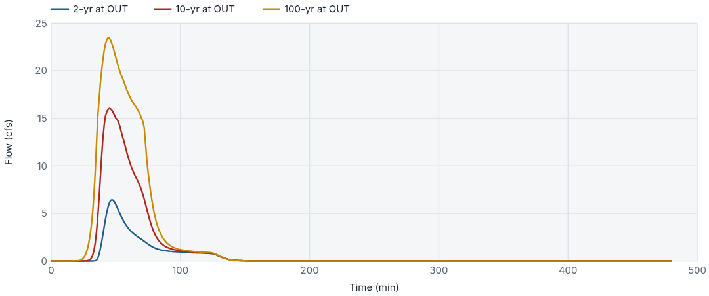

**Other unit hydrographs** (PR #87). A `UH` column in `[Subbasins]` chooses each sub-basin's
transform:

- blank or `scs`: the NRCS curve, as before.
- `clark`: the HEC-HMS time–area curve from Tc, routed through a linear reservoir; the `Clark R (min)` column is required.
- `snyder`: tp = Ct·(L·Lca)^0.3 and qp = 640·Cp·A/tpR, from the `Ct`, `Cp`, `L (mi)` and `Lca (mi)` columns, with a gamma-curve shape through that peak.
- `cuhp`: the CUHP lag tp = Ct·(L·Lca/√S)^0.48, with the same peak and shape. Ct and Cp are entered from MHFD USDCM Vol. 1 Ch. 6.

This answers the IDCM's naming of the Snyder unit hydrograph (§4.3.7). The sub-basin table states the unit hydrograph
used on each row.

## Flood frequency (Bulletin 17C)

Free · `flood-frequency` · Merged (PR #64)

Fits the log-Pearson Type III distribution to a gage's annual peaks by USGS Bulletin 17C (England et al., 2019) and
gives Q2 to Q500 with confidence limits, plotting positions and a frequency chart.

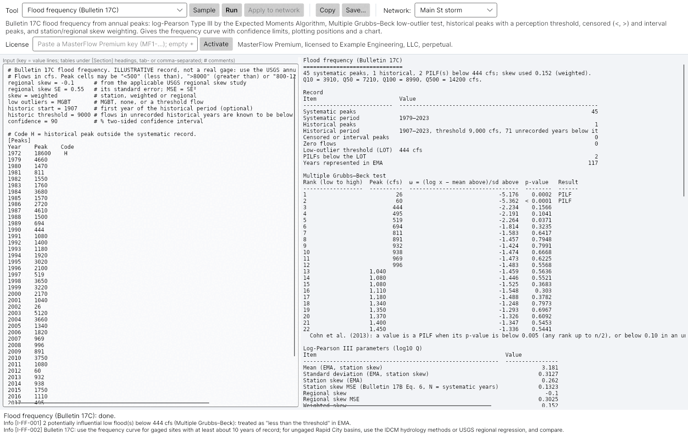

**Input.** `regional skew`, `regional skew SE`, `skew` (`station`, `weighted`, `regional`), `low outliers` (`MGBT`,
`none` or a threshold), `historic start`, `historic threshold`, `confidence` (default 90 %). `[Peaks]`: Year, Peak, Code.
A peak may be a number, `<x`, `>x` or `a-b`; code `H` marks a historical peak. Zero flows are allowed.

**Method.** Multiple Grubbs–Beck low-outlier test (Cohn et al., 2013); Expected Moments Algorithm (Cohn, Lane and Baier,
1997) for censored, interval and historical data; weighted skew with the Bulletin 17B MSE; exact Pearson III frequency
factors from the inverse incomplete gamma function; Weibull or Hirsch–Stedinger plotting positions.

**Limits.** Confidence limits use the Bulletin 17B noncentral-t approximation, so they differ from PeakFQ's EMA variance;
check against PeakFQ for formal submittals. Ungaged Rapid City basins use IDCM hydrology (I-FF-002).

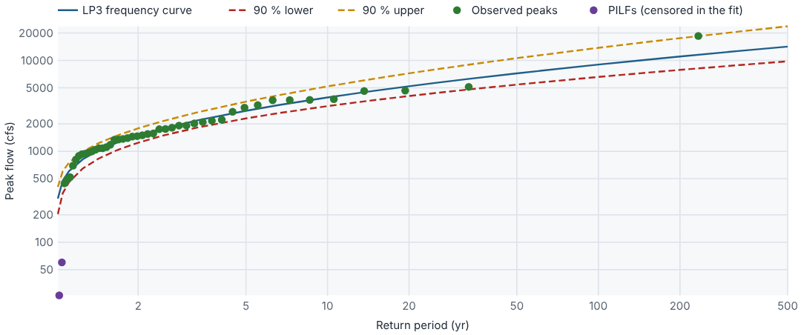

## Regional regression peak flows (HDS-2)

Free · `regional-regression` · Merged (PR #88)

Peak discharges at an ungaged site from the USGS regional regression equations for the region (FHWA HDS-2 Ch. 5). The
equations are typed in from the USGS report or a StreamStats report: `[Variables]` (name, site value, and the range of
the report's data) and `[Equations]` (T, C, one exponent column per variable, SEP % or Slog, EYR).

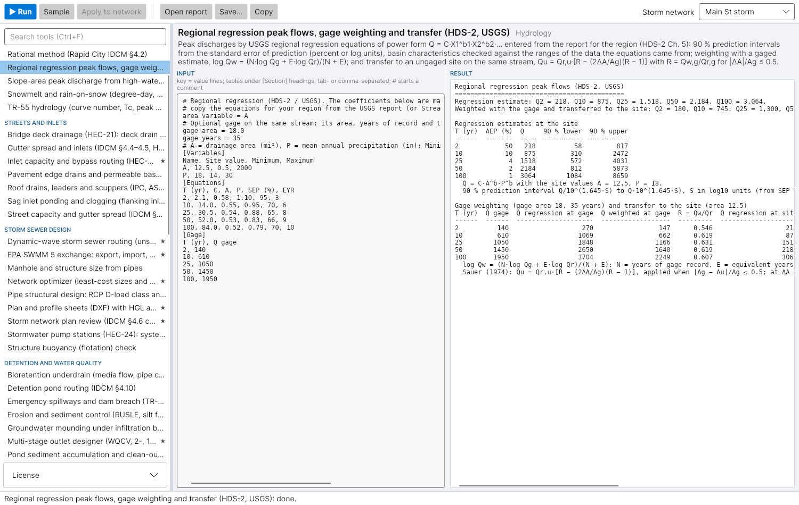

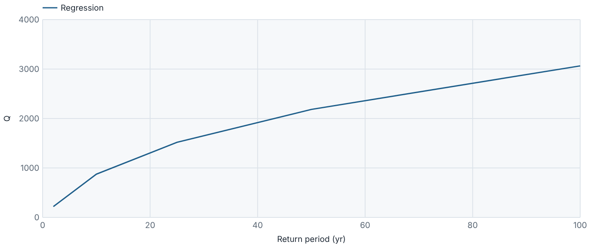

**Output.** Q for each return period with 90 % prediction intervals, and a warning for any basin characteristic outside
the report's range. With a gage on the same stream (`gage area`, `gage years`, `[Gage]` from Bulletin 17C), the estimate
is weighted by equivalent years of record and transferred to the site by Sauer's area-ratio method, within 50 % of the
gage's drainage area.

## Snowmelt and rain-on-snow

Free · `snowmelt` · U.S. units · Merged (PR #82)

Daily snowpack accounting for spring melt and rain-on-snow events. Precipitation is snow at or below the threshold
temperature (34 °F). On dry days, melt is Cm·(Ta − 32). On rain days it follows the USACE EM 1110-2-1406 rain-on-snow
equations (open or partly forested, with wind, or heavily forested above 60 % canopy). The pack holds liquid water up
to a fraction of its water equivalent. The output is snow water equivalent, melt and water available for runoff each
day, with the peak day to use as rainfall in a runoff model.

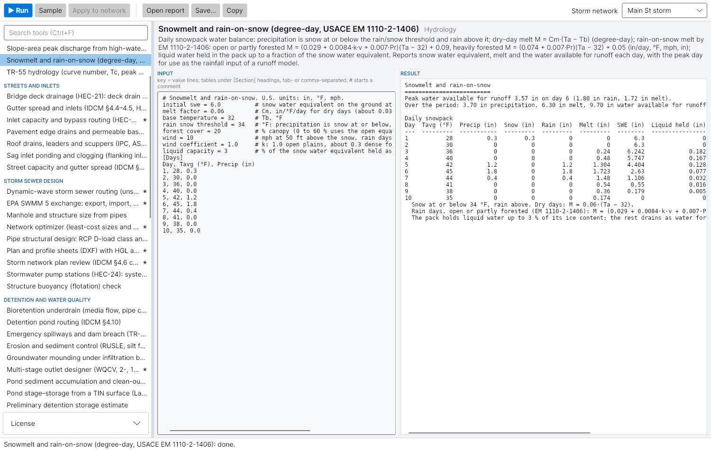

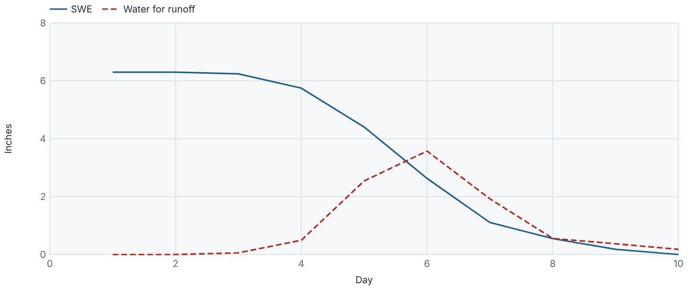

## Slope-area peak discharge

Free · `slope-area` · Merged (PR #98)

Estimates the peak discharge of a flood that has already passed, from surveyed cross-sections and the high-water marks
it left, by the slope-area method of Dalrymple and Benson (USGS TWRI Book 3 Ch. A2). Use it to check a gage, calibrate a
model or document a damaging event.

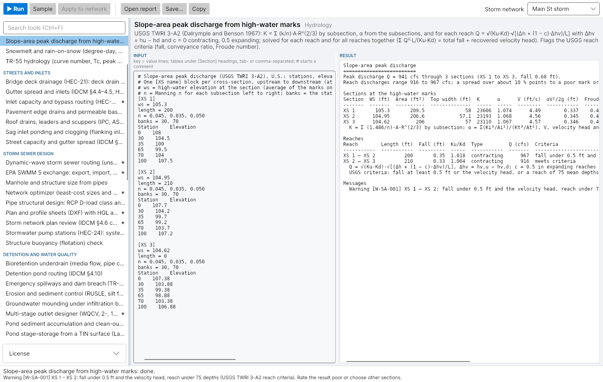

**Input.** One `[XS n]` block per cross-section, upstream to downstream (two or more, three preferred): `ws`
(high-water elevation), `length` to the next section, `n` per subsection, `banks` (stations that split the
subsections) and the station–elevation points.

**Method.**
- Each subsection's conveyance is K = (k/n)·A·R^(2/3), and α comes from the subsection conveyances.
- Each reach gives Q = √(Ku·Kd)·√[(Δh + (1 − c)·Δhv)/L], where c = 0.5 for an expanding reach and 0 for a contracting one.
- The whole-reach solution combines all sections and is the reported result.
- The TWRI criteria are flagged: the fall, the conveyance ratio Ku/Kd between 0.8 and 1.25, expanding reaches and Froude number.

# Streets and inlets

## Gutter spread and inlets

Free · `gutter-inlets` · U.S. units

Inlets in flow order along one gutter, each taking its local flow plus the bypass from the inlet above.

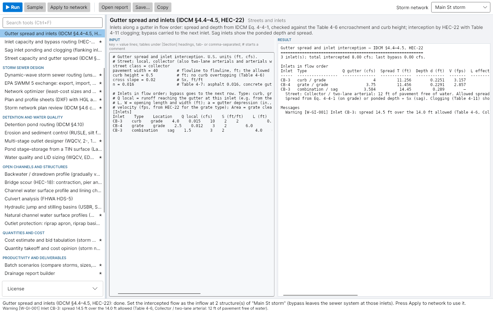

**Input.** `street class` (local, collector, arterial3, arterial4), `pavement width`, `curb height`, `cross slope`, `n`.
`[Inlets]`: Inlet, Type (curb, grate, combination), Location (grade, sag), Q local, S, L, W, a, Vo, Area, h.

| Item | Method |
|---|---|
| Spread | IDCM Eq. 4-4-1, Q = (0.56/n)Sx^1.67 S^0.5 T^2.67 (exponents as printed, D-054), d = T·Sx |
| Velocity | IDCM Eq. 4-4-2 |
| Allowed spread | IDCM Table 4-6 by street class; no curb overtopping |
| Curb opening on grade | HEC-22 Eq. 4-22, LT = 0.6Q^0.42 S^0.3 (1/(n·Se))^0.6, E = 1 − (1 − L/LT)^1.8 |
| Grate on grade | E = Rf·Eo + Rs(1 − Eo); splash-over Vo entered from HEC-22 for the grate |
| Sag | Weir and orifice equations; the lesser governs |
| Clogging | IDCM Table 4-11: grate 40 %, combination 33 % in a sag, curb 0 % |

**Apply to network** sets each named structure's inflow to the flow it intercepts. For a whole network with bypass
routing use the premium inlet tool below.

## Street capacity and gutter spread

Free · `street-capacity` · U.S. units

One street section, any number of reaches, each checked for the initial (10-yr) and major (100-yr) storms, with the
allowable capacity of each so inlet locations can be set from it (IDCM §4.4.9–4.4.11, HEC-22).

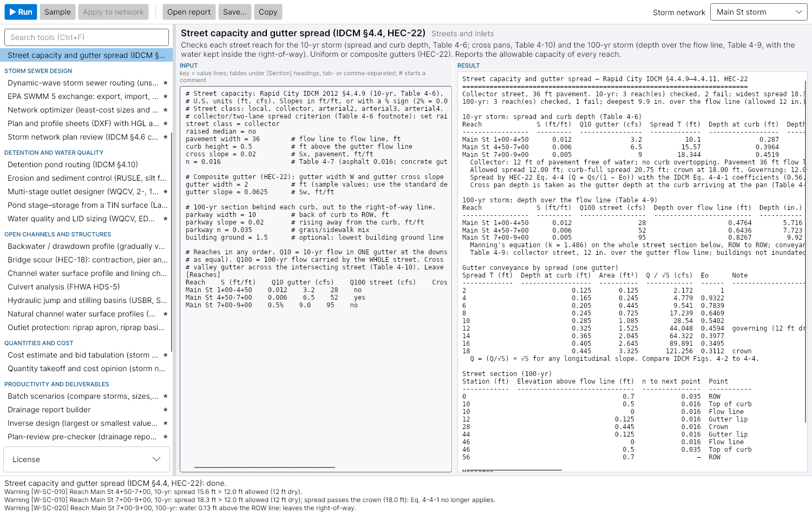

| Item | Method |
|---|---|
| 10-yr spread | Uniform: IDCM Eq. 4-4-1. Composite gutter: HEC-22 Eq. 4-4 with the IDCM exponents |
| 10-yr limits | Table 4-6: no curb overtopping; local to the crown; collector and two-lane arterial 12 ft dry; three-lane 24 ft; more lanes 36 ft |
| Cross pans | Table 4-10: depth ≤ 6 in. on local and collector streets; none on arterials |
| 100-yr depth | Manning's equation on the full section, right-of-way to right-of-way, conveyance summed where n changes; limit over the flow line local 18 in., collector and arterial 12 in. (Table 4-9); water above the ROW or a building ground line fails |
| Q allowed | 10-yr at the governing spread; 100-yr the lesser of Q at the Table 4-9 depth and Q at the ROW line |

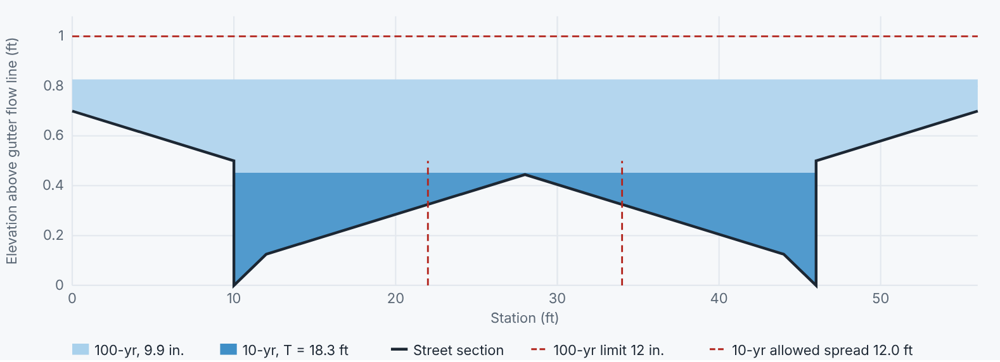

## Inlet capacity and bypass routing ★ Premium

`inlet-network` · U.S. units

Every inlet in a storm network, on grade or in a sag, with its bypass carried to the next inlet downstream. Adds
composite gutters, built-in grate splash-over constants, combination inlets with a sweeper curb opening, the HEC-22 sag
transition and an optional minor-storm run.

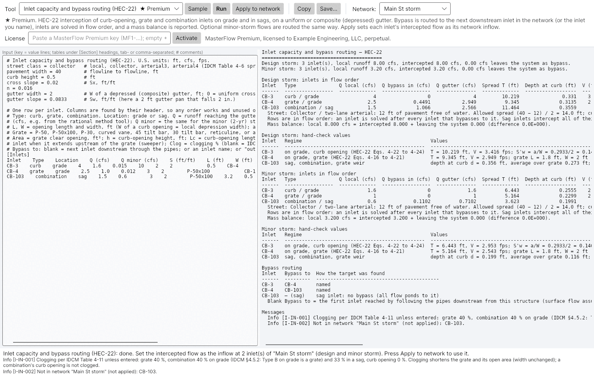

**Input.** Street data (class, width, curb height, Sx, n, optional gutter width W and slope Sw). `[Inlets]` with columns
found by header: Inlet, Type, Location, Q, Q minor, S, L, W, a, Grate (`P-50`, `P-50x100`, `P-30`, `curved vane`,
`45 tilt bar`, `30 tilt bar`, `reticuline`, or a Vo), Area, h, Lc, Clog, Sx, n, Bypass to.

**Method.** Uniform and composite gutters (HEC-22 Eq. 4-4); curb opening on grade (HEC-22 Eqs. 4-22 to 4-24); grate on
grade (Eqs. 4-18, 4-19) with splash-over constants from MHFD USDCM Vol. 1 Table 7-6; combination inlets per HEC-22
§4.4.4.4; sag grates, curb openings and combinations with weir, orifice and transition flow; clogging from IDCM Table 4-11.
Bypass follows the outlet pipe downstream to the next inlet in the table unless **Bypass to** names another inlet or
`out`. Inlets are solved in topological order, so several can bypass to one; a loop is an error. A mass balance is shown
under each storm, and a hand-check table prints every intermediate value.

**Apply to network** sets each inlet's inflow (and minor inflow) to its intercepted flow.

## Sag inlet ponding and clogging

Free · `sag-ponding` · U.S. units

For one sag on a vertical curve: the ponded depth, spread and ponded length for the 10-yr and 100-yr flows with inlets
clean, clogged per IDCM Table 4-11, and with the low-point inlet fully clogged. Flanking inlets and an overland overflow
relieve the low point.

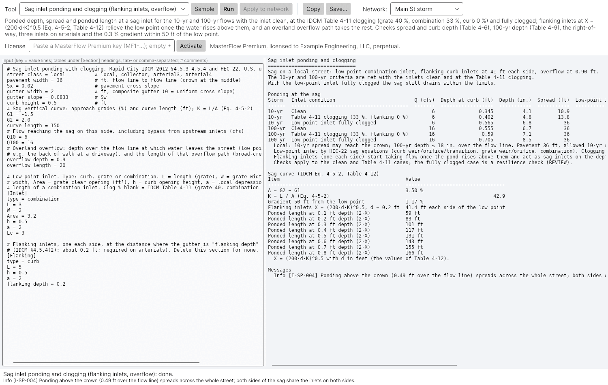

| Item | Requirement | Source |
|---|---|---|
| Clogging | Grate 40 %, combination 33 %, curb 0 % | IDCM Table 4-11 |
| 10-yr spread, 100-yr depth | As for the street capacity tool | Tables 4-6, 4-9 |
| Flanking inlets | Required on arterials; placed where the gutter is about 0.2 ft above the low point | §4.5.4(2) |
| Flanking distance | X = (200·d·K)^0.5, K = L/A, with d in feet (Table 4-12's values are reproduced in feet despite its "inches" header) | Eq. 4-5-2, Table 4-12 |

The fully clogged case is a resilience check and reports REVIEW, not FAILS.

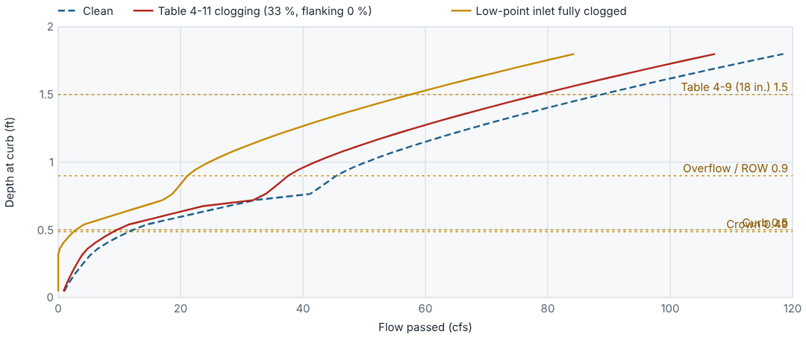

## Bridge deck drainage (HEC-21)

Free · `deck-drainage` · U.S. units · Merged (PR #75)

Lays out deck drains along one gutter of a bridge by FHWA HEC-21. It gives the length to the first drain at the
allowable spread, L1 = 43,560·(Qallow − Qapproach)/(C·i·W), and the grate or scupper efficiency on grade by the HEC-22
equations with clogging. From those it finds the spacing of later drains, the number of drains and the flow leaving
the end of the deck. A scupper is treated as a D × D opening with a low splash-over velocity (D-430).

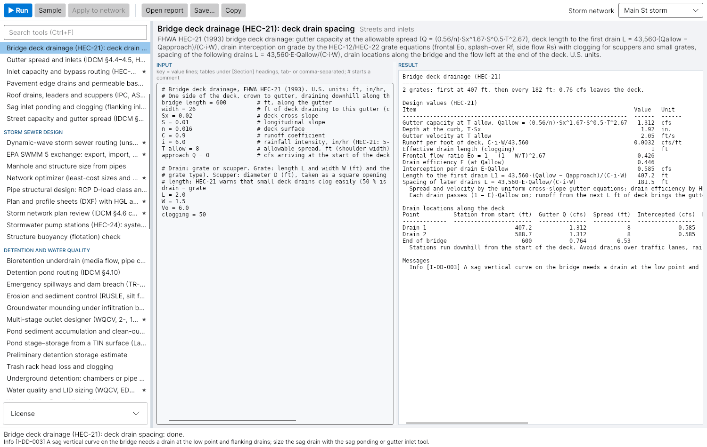

## Pavement edge drains and permeable base

Free · `pavement-edge-drain` · U.S. units · Merged (PR #83)

Pavement subsurface drainage by FHWA-NHI-99-028. It computes Cedergren infiltration qi = Ic·(Nc/W + Wc/(W·Cs)) + kp
and the resultant slope and flow path length. It checks the permeable base's steady capacity k·H·SR against qi·LR. Time
to drain 50 % comes from the sloping-layer Boussinesq equation solved numerically, and is rated by the AASHTO quality of
drainage (excellent 2 h, good 1 day, fair 1 week, poor 1 month). Edge drain capacity by Manning gives the maximum
outlet spacing.

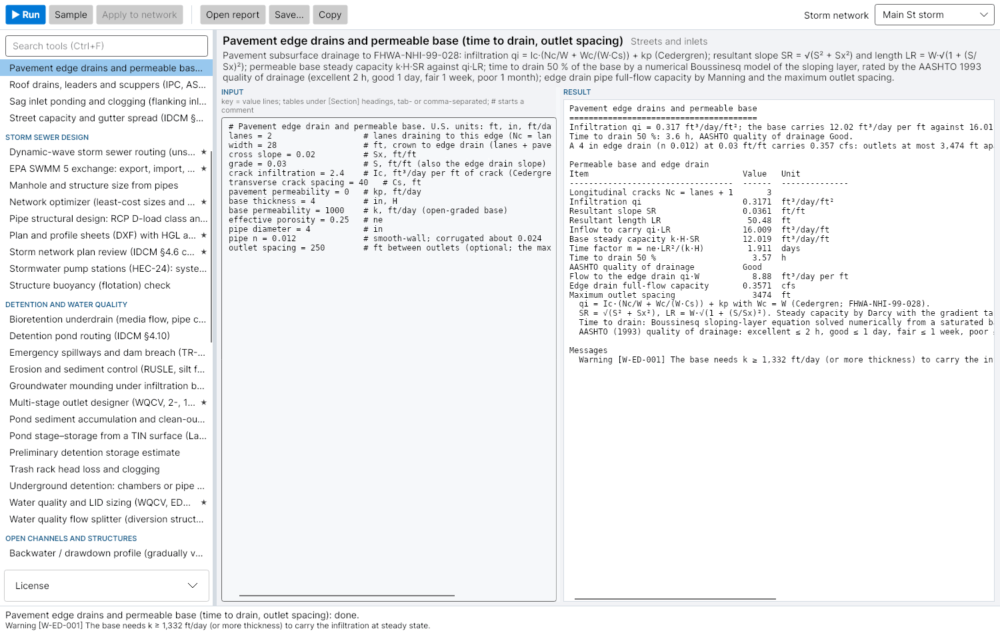

## Roof drains, leaders and scuppers

Free · `roof-drainage` · Merged (PR #94)

Sizes building roof drainage for the site plan by the IPC. It covers the roof drain leaders, the horizontal building
storm drain to the site system and the secondary scuppers. It also gives the ASCE 7 rain load the structural engineer needs.

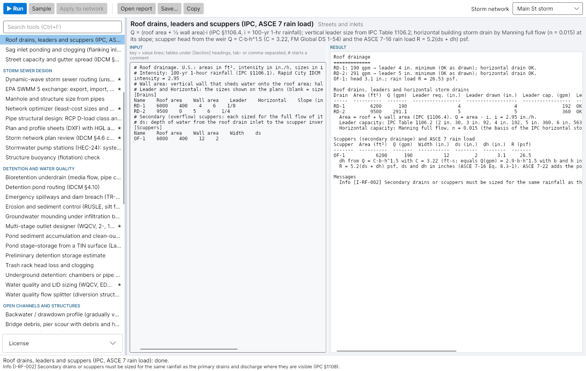

**Input.** `intensity` (100-year 1-hour, IPC §1106.1; IDCM Table 4-2 gives 2.95 in./h), `weir C`;
`[Drains]` (roof and wall area, drawn leader and horizontal sizes, slope) and `[Scuppers]` (area, width, static head ds).

**Method.**
- Area is the roof plus half of any vertical wall draining onto it. Q (gpm) = 0.0104·A·i.
- Leaders are sized from IPC Table 1106.2.
- The horizontal drain is checked by Manning full flow with n = 0.015, which reproduces the IPC table.
- Scupper head comes from the weir equation Q = C·b·h^1.5.
- Rain load R = 5.2(ds + dh) psf (ASCE 7-16 Eq. 8.3-1).

# Storm sewer design

## Storm network plan review (IDCM §4.6) ★ Premium

`network-plan-review`

Reviews the selected, solved network and lists one row per finding: FAIL, REVIEW or OK, the check, the IDCM section, the
pipe or structure, the value and the limit.

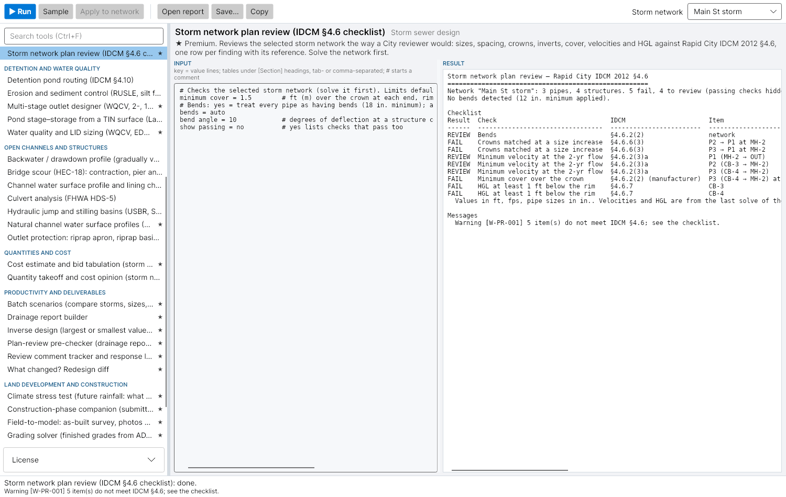

| Check | IDCM | Rule |
|---|---|---|
| Minimum pipe size | §4.6.2(2) | 12 in.; 18 in. when the system has bends |
| Material and n | §4.6.2(2) | RCP above 18 in. with n ≥ 0.013; PVC n ≥ 0.010 |
| Structure spacing | §4.6.3 | ≤ 400 ft for pipes ≤ 30 in.; ≤ 600 ft above |
| Larger into smaller | §4.6.6(2) | Never |
| Crown matching, outlet invert | §4.6.6(3) | Outgoing crown not above incoming; 0.8D matching is REVIEW |
| Velocity progression | §4.6.6(1) | Drop of more than 10 % is REVIEW |
| Slope below critical | §4.6.6(4) | Steep pipes REVIEW |
| Minimum velocity | §4.6.2(3)a | 2.5 ft/s at the 2-yr flow (REVIEW when no 2-yr flow) |
| Maximum velocity | §4.6.2(3)b, Table 4-13 | 20 ft/s on collectors and mains |
| Cover | §4.6.2(2) | Rim − crown at each end ≥ `minimum cover` (default 1.5 ft) |
| HGL | §4.6.7 | At least 1 ft below the rim |

The review reads only the solved network, so it can never disagree with the HGL report.

## Network optimizer ★ Premium

`network-optimizer`

Chooses pipe sizes and inverts for the selected network at **least cost** (pipe price × length, trench excavation and
structure depth) or **least excavation**, while every pipe and structure meets the rules. Flows, lengths, n, locations
and rims are not changed. **Apply to network** writes the sizes and inverts and re-solves.

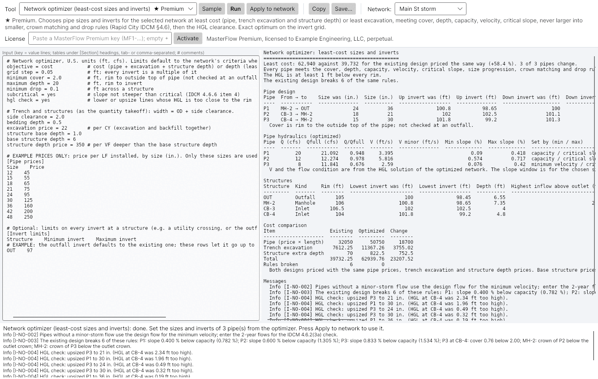

**Rules met by every design:** part-full capacity (Q ≤ `maximum fill` × Qfull); minimum velocity at the minor flow and
maximum at the design flow; slope not steeper than critical; minimum size; never larger into smaller; crowns matched or
dropped; `minimum drop` across structures; `minimum cover` and `maximum depth` at both ends; `[Invert limits]` per
structure (the outfall cannot go below its existing invert unless allowed); optional slope limits; and the HGL criterion.

**Method.** Exact dynamic programming over the branching network on an invert grid (`grid step` 0.05 ft), linear in the
number of invert levels; checked against brute-force enumeration (D-080). The HGL is then checked with the full solver;
where a structure's HGL is too high, upsizing up to six pipes on its path or lowering its outlet is tried and the change
with the most clearance per dollar is kept (D-081). This outer loop is a heuristic.

**Output.** Pipe design (old and new sizes and inverts, slope window and what sets it, Q/Qfull, V, cover), structures,
cost comparison of existing and optimized designs with the rules each breaks, and a profile chart.

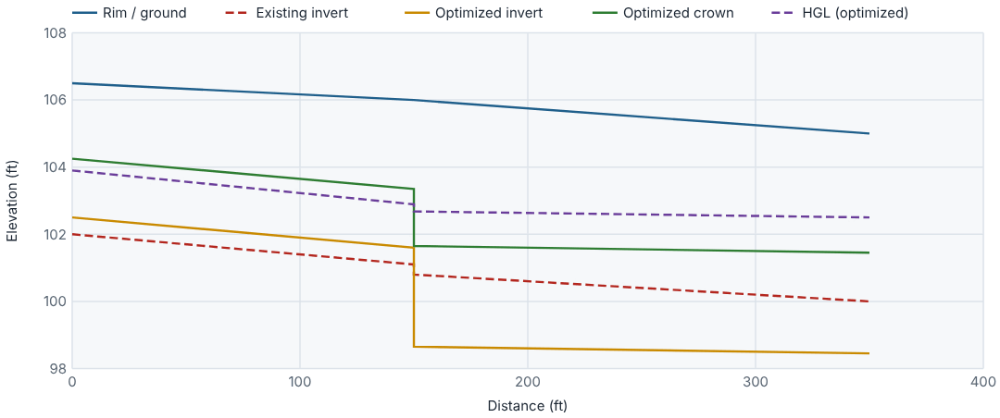

## Plan and profile sheets (DXF) ★ Premium

`plan-profile-dxf`

Draws the selected, solved network as plan and profile sheets in an R12 ASCII DXF that AutoCAD and Civil 3D open, with
the HGL and EGL from the solution. **Save…** offers `.dxf`.

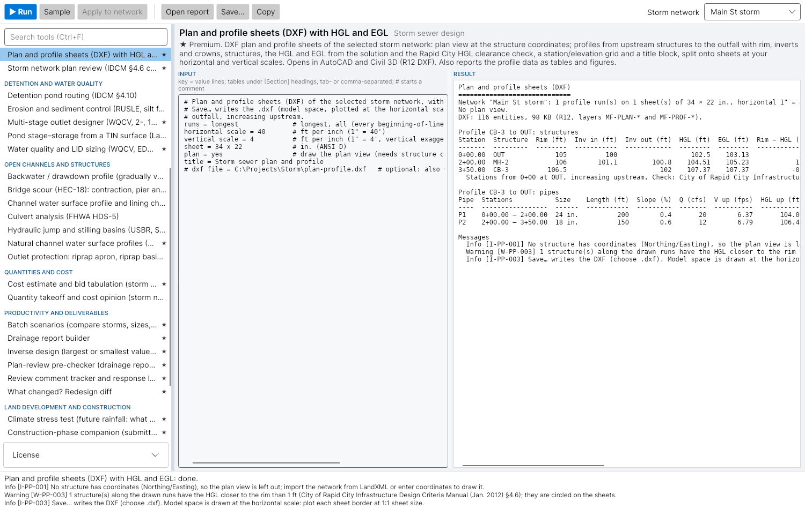

**Input.** `runs` (`longest`, `all`, or structure names), `horizontal scale` and `vertical scale` (default 1"=40' and
1"=4'), `sheet` (default 34 × 22 in.), `plan` (yes/no), `title`, `dxf file`.

**Drawing.** Model space at true size: the plan at the structures' coordinates (it overlays the Civil 3D drawing), the
profile sheets stacked below. Profiles run from 0+00 at the outfall upstream, with a station/elevation grid, rim line,
inverts and crowns, structure boxes labelled with rim, inverts, HGL and EGL, the HGL (solid) and EGL (dashed) inside
each pipe from the solver's own profile points, and a circle on any structure whose HGL is within the criterion of the
rim. Layers are named `MF-PLAN-*`, `MF-PROF-*` and `MF-SHEET`.

## EPA SWMM 5 exchange ★ Premium

`swmm-exchange` · Merged (PR #61)

Moves the selected network into and out of EPA SWMM 5, so a dynamic-wave run can check the steady HGL, or a SWMM model
from a consultant or the City can be checked against the IDCM.

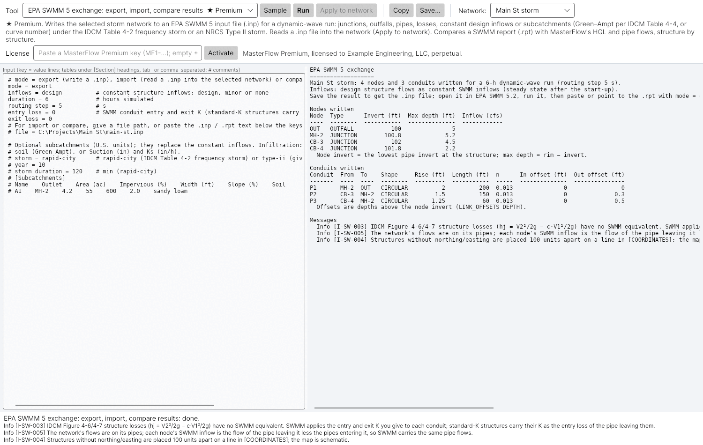

| `mode` | What it does |
|---|---|
| `export` (default) | Writes `.inp`: options (DYNWAVE, CFS or CMS), junctions (invert = lowest pipe invert, max depth = rim − invert), outfalls (FREE or FIXED), conduits and cross-sections (circular, elliptical), entry and exit losses, constant inflows (`design`, `minor` or `none`), optional sub-catchments with CN or Green–Ampt (IDCM Table 4-4), rain gage with the IDCM frequency storm or Type II, coordinates |
| `import` | Reads `.inp` (`file =` or pasted) into the selected network; **Apply to network** replaces its structures and pipes and keeps its name and criteria. Pumps, weirs, orifices, other shapes and multi-barrel conduits are reported and left out |
| `compare` | Reads a SWMM `.rpt` and lists, per structure, MasterFlow's HGL against SWMM's peak HGL, rim clearance, flooding, and pipe flows; "check" where they differ by more than 0.1 ft |

IDCM Figure 4-6/4-7 structure losses cannot be expressed in SWMM; they are left to the conduit entry and exit K you choose
(D-331). The files have not yet been opened in SWMM itself.

## Dynamic-wave storm sewer routing ★ Premium

`dynamic-wave` · Merged (PR #65)

Routes inflow hydrographs through the selected network by the full St. Venant equations, using the link-node method of
EPA SWMM 5 (Rossman, *SWMM Reference Manual Vol. II*, 2017, Ch. 3). Where the steady HGL assumes every pipe carries its
peak at once, this follows the flood wave in time, with storage in pipes and structures, backwater, surcharge, flooding
at the rim and flow reversal.

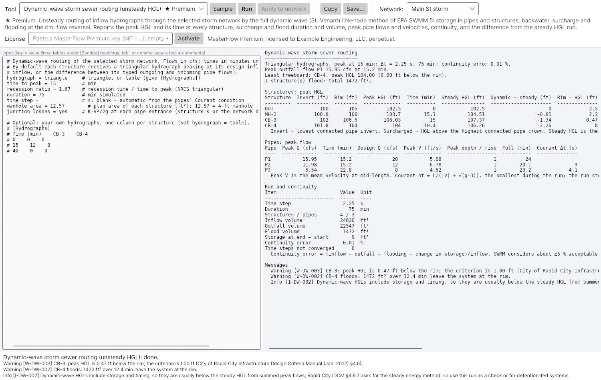

**Input.** `hydrograph` (`triangle` peaking at each structure's design inflow, or `table` under `[Hydrographs]`),
`time to peak`, `recession ratio` (1.67), `duration`, `time step` (blank = automatic, 0.25–5 s), `manhole area`
(default a 4-ft manhole), `junction losses`.

**Method.** Link momentum by SWMM Eq. 3-13 with friction, pressure, damped inertial and loss terms; node continuity with
the SWMM surcharge algorithm; flooding above the rim leaves the system; outfall at the network tailwater; up to 8 Picard
iterations per step.

**Output.** Structures: peak HGL and time, the steady HGL and difference, rim − HGL, surcharge and flood duration, flood
volume. Pipes: peak flow and time, peak velocity, depth/rise, full-flow time, Courant time. Continuity, and charts of HGL
and flow against time and the peak HGL profile. The IDCM §4.6.7 criterion is a steady requirement; the dynamic result is
a check (I-DW-002).

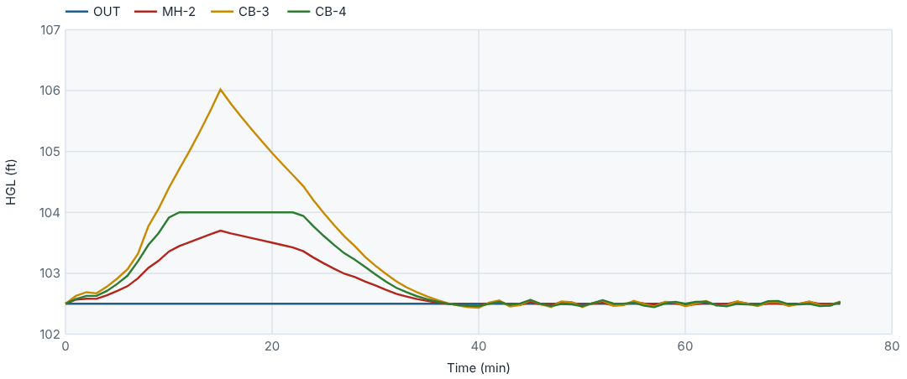

## Stormwater pump stations (HEC-24)

Free · `pump-station` · U.S. units · Merged (PR #86)

Checks an underpass or depressed-roadway pump station by FHWA HEC-24. Input:

- the pump curve and the pumps' start and stop levels
- the wet-well and storage stage–volume table
- the force main (length, diameter, Hazen-Williams C, minor losses)
- the design inflow hydrograph

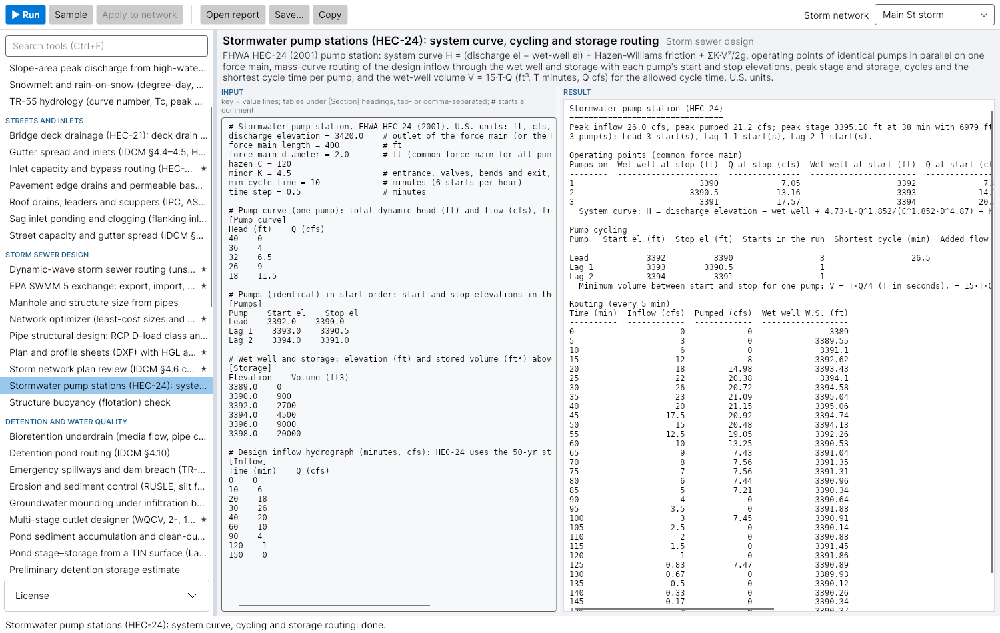

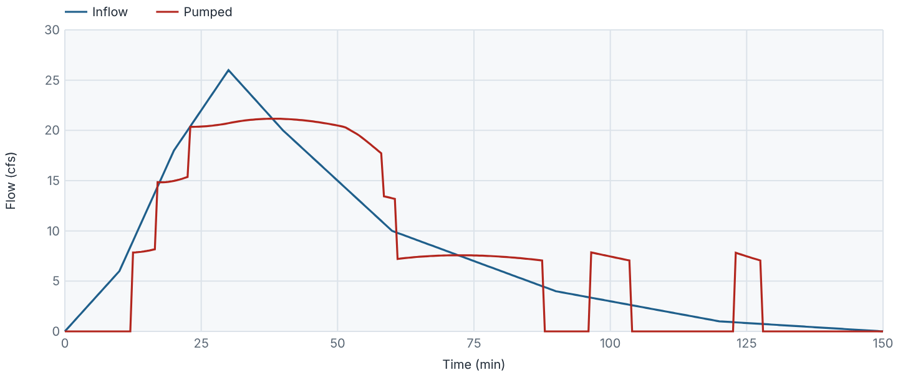

The system curve and parallel pump operating points are solved, and the inflow is routed by mass curve as pumps start
and stop. The tool reports peak stage, starts and shortest cycle time, and checks each pump's cycle volume against
HEC-24's V = 15·T·Q. Identical pumps on one force main are assumed (D-460).

## Manhole and structure size from pipes

Free · `manhole-sizing` · Merged (PR #91)

Finds the smallest round manhole or inlet structure whose barrel wall can take all of its pipes, rounded up to the
precaster's sizes. Pipe sizes, inverts and plan angles are read from the selected storm network when the cells are left
blank.

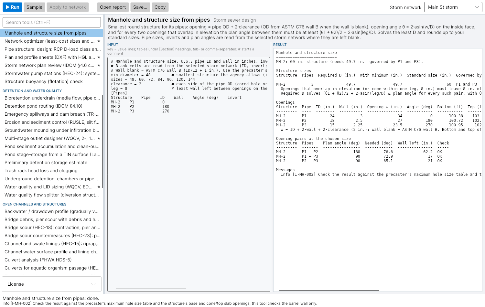

**Input.** `min diameter`, `sizes` (standard inside diameters), `clearance` (each side of the pipe OD), `leg`
(least wall between openings); `[Pipes]`: structure, pipe, ID, wall (blank = ASTM C76 wall B), plan angle, invert.

**Method.**
- Each opening is w = ID + 2·wall + 2·clearance wide and subtends 2·asin(w/D) on the inside face.
- Openings whose vertical bands overlap, or come within one leg of each other, need enough plan angle between them for both half-openings plus the leg.
- The least D that meets every such pair is found by bisection, then rounded up to the next listed size. The governing pair is reported.

## Pipe structural design: RCP class and flexible pipe deflection

Free · `pipe-structural` · Merged (PR #92)

Checks buried storm pipe for earth and traffic load. For reinforced concrete pipe it gives the ASTM C76 D-load class.
For flexible pipe (HDPE, PP, PVC and metal) it gives the deflection.

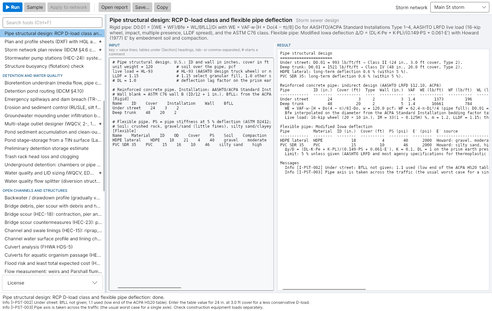

**Input.** `unit weight`, `live load` (`HL-93` or `none`), `LLDF`, `DL`; `[Rigid]`: ID, cover, Standard
Installation type 1–4, wall, BfLL; `[Flexible]`: material, ID, OD, cover, pipe stiffness, soil, compaction, E′, deflection limit.

**Method.**
- **Rigid pipe** uses indirect design (AASHTO LRFD §12.10.4.3 and the ACPA design manual):
  - earth load with the Standard Installation VAF;
  - fluid load;
  - HL-93 wheel load spread through the fill, with the impact allowance;
  - bedding factors from the ACPA table.
  - D0.01 = [(WE + WF)/Bfe + WL/BfLL]/Di. The class is the least C76 class at or above it.
- **Flexible pipe** uses the Modified Iowa formula, with E′ from Howard (1977) by embedment and compaction, checked against the deflection limit (default 5 %).

## Structure buoyancy (flotation)

Free · `structure-buoyancy` · Merged (PR #93)

Checks an empty manhole, inlet, vault or outlet structure against flotation at the design high groundwater. When it
fails, the tool gives the ballast concrete or base extension that fixes it.

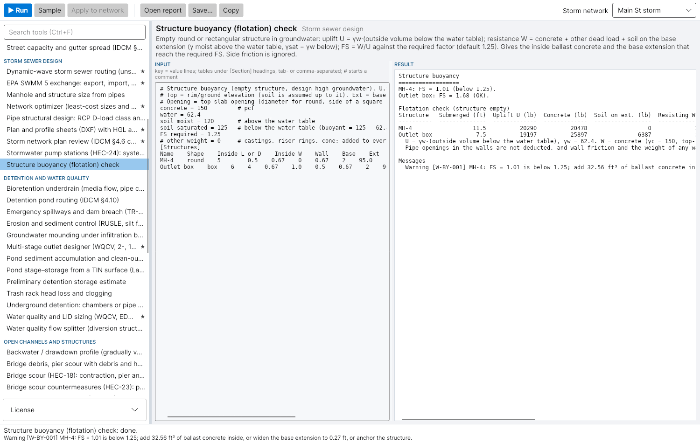

**Input.** Unit weights of concrete, water and soil (moist and saturated), `FS required` (default 1.25), `other weight`;
`[Structures]`: round or box, inside size, wall, base, extension, top slab and opening, bottom, top and groundwater elevations.

**Method.**
- Uplift is the water displaced by the outside volume below the water table.
- Resisting weight is the concrete plus the soil on the base extension. The soil is moist above the water table and buoyant below it.
- FS = resisting weight / uplift.
- The ballast needed inside is (FS·U − W)/γc. The base extension that reaches the required FS is found by bisection.

# Detention and water quality

## Detention pond routing

Free · `detention-routing` · U.S. units

Routes the 2-, 10- and 100-yr storms through a pond and checks it against IDCM §4.10.

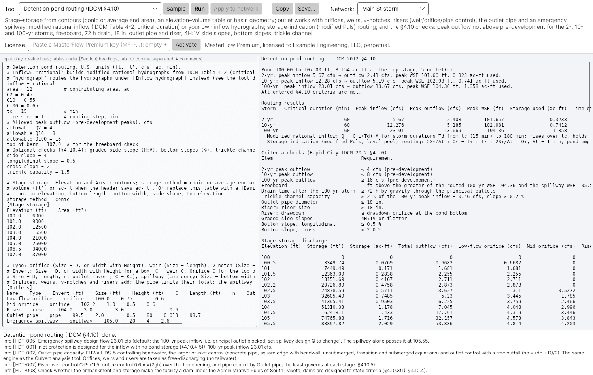

| Item | Method |
|---|---|
| Stage–storage | `[Stage storage]` Elevation, Area (conic or average end area), or Elevation, Volume (e.g. a Civil 3D report), or `[Basin]` geometry (exact prismoidal volume) |
| Outlets | Orifice (full and below the crown), weir, V-notch, riser (least of weir and orifice control), outlet pipe barrel by HDS-5 inlet and outlet control (limits the sum of the openings), emergency spillway (broad-crested trapezoid beside the barrel) |
| Inflow | `rational` (modified rational, §4.10.7: every duration from t_c to 180 min, the one with the highest level governs) or `hydrograph` (`[Inflow hydrograph]` columns such as `100-yr (cfs)`) |
| Routing | Storage indication (modified Puls), `time step` 0.1–10 min |

**Criteria checks (OK / FAILS / NOT CHECKED).** Peak outflows ≤ `allowable Q2/Q10/Q100` (§4.10.3(2), §4.10.4); freeboard
1 ft above the greater of the routed 100-yr WSE and the spillway WSE at its design flow (§4.10.4(4), D-063); drain time
≤ 72 h (§4.10.5); outlet pipe ≥ 18 in. and riser drawdown orifice (§4.10.5); side slopes 4H:1V or flatter (§4.10.4(2));
bottom slopes (§4.10.4(1)); trickle channel ≥ 2 % of the 100-yr inflow (§4.10.4(3)); spillway side slopes (§4.10.6).

**Output.** Routing results, criteria, stage–storage–discharge, outlet works, routed hydrographs, and charts of
inflow/outflow per storm, WSE, stage–discharge and stage–storage. A pond that fills above the top stage is reported as
overtopping, never extrapolated. Validated against two independent routings within 0.2 % and 0.003 ft.

## Pond stage–storage from a TIN

Free · `pond-storage`

Builds the stage–area–volume table straight from the graded surface, so the storage used for routing is the storage
that is graded.

**Input.** `surface file` (LandXML from Civil 3D) and `surface` name, or `[TIN points]` and `[TIN faces]`; optional
`[Boundary]` polygon (triangles whose centroid is inside count); `interval`; `bottom`, `top`.

**Method.** Each triangle is clipped to the part below the level water surface; the volume ∫(WSE − z)dA is exact for the
TIN (no contour interval error, D-125). The rim's lowest vertex is the spill elevation; stages above it are flagged.

**Output.** Stage, depth, area, volume (ft³, ac-ft), the conic-method volume and difference, ready-to-paste blocks for the
detention tool and the outlet designer, and stage–storage and stage–area charts. Checked against the prismoidal formula
to 1×10⁻⁶ ft³.

## Multi-stage outlet designer ★ Premium

`outlet-designer` · U.S. units

Designs the outlet structure of a pond from the bottom up: WQCV plate, storm stages, outlet pipe, and spillway, then
checks it against the Rapid City criteria. The detention tool analyses an outlet you have drawn; this tool sizes one.

| Item | Requirement | Source |
|---|---|---|
| Release | 2-, 10-, 100-yr peaks ≤ pre-development | IDCM §4.10.3(2), §4.10.4 |
| WQCV | Storage 120 % of WQCV above the lowest perforation; WQCV released in 40 h, ≤ 50 % in 12 h | SWQM §2.2.2, §2.3.2 |
| Freeboard | 1 ft above the 100-yr level and above the spillway passing the 100-yr | IDCM §4.10.4(4) |
| Outlet pipe | RCP, 18 in. minimum | IDCM §4.10.5 |
| Drain time | 72 h after the 100-yr storm | IDCM §4.10.5 |

**Method.** Modified rational inflow (the duration with the highest *outflow* governs for each trial, D-107) or entered
hydrographs; WQCV from imperviousness (SWQM equation); plate holes sized exactly to drain the WQCV in 40 h; each
`[Stages]` row (orifice, slot or weir) is sized as the smallest opening that holds every storm j ≥ k at its allowable
(D-106); the outlet pipe is the smallest standard size from 18 in. that does not throttle the stages; a final routing of
every storm gives the checks. The 72-h check is shown as a warning for a 40-h plate with sediment zone (the SWQM does not
say whether its 40 h counts toward the IDCM's 72 h).

## Water quality and LID sizing ★ Premium

`water-quality`

Computes the WQCV of each sub-basin, sizes the BMP each one drains to, and reports the share of impervious area treated
for MS4 reporting. `criteria = rapid city` (default, SWQM 2009 via IDCM §4.1.7) or `mhfd` (MHFD USDCM Vol. 3, every
coefficient an input).

**WQCV (SWQM §2.2.2).** WQCV = 1.16·a·(0.91I³ − 1.191I² + 0.78I) watershed inches (coefficient 1.191 as printed), a = 0.7,
0.8, 0.9, 1.0 for 6, 12, 24, 40 h drain time; design credits (§2.4.2) reduce the effective area.

| BMP (`type =`) | Rapid City rule (SWQM) | What the tool does |
|---|---|---|
| `porous landscape detention` | §2.3.1: 12 h; average depth 6–12 in.; ≥ 18 in. media | Area = WQCV / average depth |
| `edb` | §2.3.2: 120 % WQCV storage; WQCV out in 40 h, ≤ 50 % in 12 h | Plate rows to the 120 % level, hole area exact for 40 h; 12-h fraction checked |
| `sand filter` | §2.3.3: 100 % WQCV, ≤ 3 ft deep, 18 in. sand over 8 in. gravel | Area by storage; Darcy drain time as a check |
| `constructed wetland` | §2.3.4: WQCV surcharge in 24 h; pool ≥ 75 % WQCV; surcharge ≤ 2 ft | Needs `permanent pool`; plate for 99 % in 24 h |
| `bioretention` | §2.3.9: ponding ≤ 6 in. (12 in. with collector pipes); soil ≥ 4 ft; project criteria: surface drains in 48 h, bed within 72 h | Larger of storage area and 48-h Darcy area; bed drainage checked |
| `infiltration` | Not a listed WQCV BMP (§2.3.10, approval) | Sized as MHFD and flagged W-WQ-006 |

**Output.** WQCV per sub-basin and BMP, plate design and drawdown, areas and which governs, treated impervious share,
and charts. The SWQM's worked examples are reproduced in the tests.

## Erosion and sediment control

Free · `erosion-sediment` · U.S. units

Checks a construction erosion and sediment control plan against SWQM 2009 Chapter 1 and estimates the soil loss with
RUSLE.

**Input.** `R` (annual erosivity from the AH 703 map; the tool does not pick one), `R fraction`, `sediment unit weight`.
`[Areas]`: Area, λ, slope, K, C, P, stabilization, exposure months, basin. `[Perimeter controls]`: type, length,
tributary area, slope length, slope. `[Basins]`: basin or trap, tributary area, volume, dimensions, orifice.

**Checks.** RUSLE A = R·K·LS·C·P (AH 703); maximum exposure by stabilization method (Table 1.1); blankets on 3:1 or
steeper (§1.2.2); perimeter control slope lengths (Table 1.2) and the silt fence 0.5 ac per 100 ft rule; sediment traps
3,600 ft³/ac and ≤ 5 ac (§1.3.3.5); sediment basins where more than 10 ac drains to one point, 3,600 ft³/ac, L ≥ 2W, drain
time ≥ 16 h, months to half full (§1.3.3.6).

## Pond sediment and clean-out interval

Free · `pond-sediment` · U.S. units · Merged (PR #81)

How fast sediment fills a forebay and a main pool, and how often each needs cleaning. The steps are:

1. **Annual load**, from either a TSS event mean concentration on the simple-method runoff Rv·P·A, or yields by land use, plus a construction-phase load.
2. **Trap efficiency**, from the Brune curve (Dendy fit) on C/I, or given.
3. **Deposit density**, by Lara and Pemberton from the sand, silt and clay fractions and the pond's operation, with Miller's consolidation.
4. **Clean-out timing**: years until each storage reaches the clean-out trigger (half full by default), both from today and as the repeating interval once the site is developed.

## Groundwater mounding (Hantush)

Free · `groundwater-mounding` · Merged (PR #78)

The rise of the water table under a rectangular infiltration basin, by the Hantush (1967) solution as programmed in USGS
SIR 2010-5102. It reports:

- the peak mound at the center
- profiles along both axes
- the mound over time through recovery
- the separation from the mounded water table to the basin floor, against the required separation

A mound above half the saturated thickness, or recharge above K, is warned: use MODFLOW for a final design.

## Bioretention underdrain

Free · `bioretention-underdrain` · U.S. units · Merged (PR #83)

Media flow by Darcy, Q = k·A·(h + d)/d, against the perforated underdrain's Manning capacity, with an optional
restricting orifice. It gives two drain times:

- the ponded water, by falling head through the media
- the drainable water in the media and gravel

These are checked against 48 h for the surface and 72 h below it by default.

## Emergency spillways and dam breach (TR-60)

Free · `spillway-breach` · U.S. units · Merged (PR #76)

For detention and stock-pond embankments under dam safety rules. It covers:

- **Design rainfall:** NRCS TR-60 auxiliary-spillway and freeboard rainfall by hazard class.
- **Spillway rating:** a weir, or critical flow in a trapezoidal earth spillway.
- **Freeboard:** checked against the routed stages.
- **Breach screen:** peak outflow by Froehlich (1995), MacDonald–Langridge-Monopolis and USBR, with Froehlich (2008) breach width and failure time.

The hydrographs are routed with the TR-55, hydrograph routing or detention tools (D-470).

## Trash rack head loss and clogging

Free · `trash-rack` · Merged (PR #95)

Checks a bar rack on a pond outlet, culvert inlet or storm sewer intake. It gives the open area, the velocity through
the rack and the head loss to add to the outlet rating, both clean and partly clogged.

**Input.** `clogging` (default 50 %), `max velocity`; `[Racks]`: Q, width, submerged height, bar thickness and clear
spacing, angle from horizontal, bar shape.

**Method.**
- The net open area is Ag·b/(b + t), reduced by the clogging share.
- Clean-rack loss uses Kirschmer (1926): h = Kt·(t/b)^(4/3)·sinθ·Va²/2g, with Kt by bar shape.
- Clean and clogged losses also use Creager and Justin (USBR): h = (1.45 − 0.45R − R²)·Vn²/2g.

## Water quality flow splitter

Free · `flow-splitter` · Merged (PR #97)

Designs the diversion structure ahead of an off-line water quality BMP, such as a sand filter, bioretention or a
proprietary device. A low orifice sends the water quality flow to the BMP and an overflow weir bypasses larger storms.

**Input.** `Q design`, `Q wq` (Rapid City SWQM 2009), `orifice invert`, either `orifice diameter` or `crest` (the
other is solved), `weir length`, `weir C`, `Cd`, and optionally `max WSE` and `max treatment flow`.

**Method.**
- The orifice passes Q wq with the water at the weir crest. Given one of crest or diameter, the tool solves the other.
- The design-storm water surface is found where orifice plus weir carry Q design. The orifice flow at that level is what still reaches the BMP, checked against `max treatment flow`.
- With `max WSE`, the tool gives the weir length that holds the water surface to it.

## Preliminary detention storage estimate

Free · `storage-estimate` · Merged (PR #99)

A first-cut detention volume for site layout and feasibility, before a pond is drawn. Size the pond itself by routing
it with the detention or hydrograph routing tools.

**Input.** `area`, `qi` and `qo` (inflow peak and allowable release); for TR-55, `CN` and `P` (or `Q runoff`) and
`rainfall type`; for the modified rational method, `C`, `tc` and `frequency` (IDCM Table 4-2), or an `[IDF]` table.

**Method.**
- **TR-55 Chapter 6:** Vs/Vr from the Figure 6-1 polynomial in qo/qi, by rainfall type.
- **Modified rational:** V = 60·[C·i·A·Td − qo·(Td + tc)/2], maximised over the storm duration Td.
- **Comparison:** the Abt–Grigg and Baker ratio methods.

## Underground detention: chambers or pipe gallery

Free · `underground-detention` · Merged (PR #100)

Lays out an underground detention bed of arch chambers or perforated pipes in washed stone and builds its
stage–storage curve. It can also find how many units per row a required volume needs. The stage–storage table pastes
into the detention routing tool.

**Input.** `unit` (`arch`, `pipe` or `curve` with a manufacturer's `[Unit curve]`), unit size, `rows`, `per row`,
`spacing`, `edge`, stone depths below and above, `porosity` (default 0.40), `bottom`, `cover` and `min cover`, and
optionally `required volume`.

**Method.**
- The bed is sized from the layout.
- Unit void at each depth comes from the semi-ellipse (arch), the circular segment (pipe) or the table (curve).
- Storage = unit void + porosity × the stone around them.
- The least units per row whose full-depth storage reaches the required volume are reported. Cover is checked against the manufacturer's minimum.

# Open channels and structures

## Backwater / drawdown profile

Free · `backwater-profile` · U.S. or SI

Water surface along a prismatic channel (rectangular, trapezoidal, triangular) or a part-full circular pipe from a
control depth, by the standard step (Chow 1959).

**Input.** `section`, `b`, `z`, `D`, `n`, `slope`, `Q`, `length`, `control depth` (or `critical`), `invert at control`,
`bank depth`, `freeboard`.

**Method.** E₂ = E₁ ∓ S₀Δx ± ½(Sf₁ + Sf₂)Δx in 200 equal steps; depth by bisection on the regime's branch; subcritical runs
upstream from a downstream control, supercritical downstream. Profile class M, S, C, H or A with zone. A control depth
the regime cannot reach is replaced by critical depth. Where the profile must pass through critical depth it stops and
says so; the jump location is not computed here (use the channel profile tool).

## Channel water surface profile and lining checks

Free · `channel-profile` · U.S. units

A multi-reach profile for a ditch, swale or channel, each reach with its own section, slope, flow, roughness and lining,
checked against IDCM §4.8 / Table 4-14 and FHWA HEC-15.

**Method.** Standard step (HEC-RAS HRM Ch. 2) with contraction (0.1) and expansion (0.3) losses where the section changes;
downstream boundary normal, critical or a WSE; mixed regime by specific force, so the jump falls where the two profiles
cross. Two runs, as Table 4-14 requires: **capacity n** (maximum, for depth and freeboard) and **stability n** (minimum,
for velocity, Froude number and shear).

| Check (Table 4-14) | Grass, erosive | Grass, nonerosive | Riprap | Concrete |
|---|---|---|---|---|
| Max velocity | 5 ft/s | 7 ft/s | 12 ft/s | 18 ft/s |
| Min velocity | 2 ft/s | 2 | 2 | 2 |
| Max Froude | 0.5 | 0.8 | 0.8 | — |
| Max depth | 5 ft | 5 ft | — | — |
| Freeboard + velocity head | 1.0 ft | 1.0 ft | 2.0 ft | 2.0 ft |
| Longitudinal slope | 0.2–0.6 % | 0.2–0.6 % | 0.2–1.0 % | — |
| Flattest side slope | 4H:1V | 4H:1V | 2.5H:1V | 1.5H:1V |

Froude numbers 0.95–1.05 are prohibited (§4.8.3). Shear τd = γ·d·Sf against an entered τp (HEC-15 Eq. 2.3). Riprap D50 by
HEC-15 §6.1, with the 20 % velocity increase at transitions (§4.8.3(2)(c)).

## Natural channel profiles (HEC-RAS method) ★ Premium

`river-profile` · Merged (PR #62)

Steady water surface profiles through surveyed natural cross-sections by the method of HEC-RAS (USACE *Hydraulic
Reference Manual*, Ch. 2), for floodplains at crossings, drainageway master plans or checks of FEMA effective sections.

**Input.** `[Points]`: RS, Station, Elevation, optional n (a Civil 3D sample-line report pastes in). `[Sections]`: RS,
bank stations, LOB/channel/ROB reach lengths to the next section downstream, n LOB/Ch/ROB, contraction, expansion,
ineffective flow areas. `[Flows]` per profile. `regime` (subcritical, supercritical, mixed), downstream and upstream
boundaries (normal, critical, known WS).

**Method.** Energy equation with discharge-weighted reach length, average-conveyance friction slope, contraction and
expansion losses; conveyance subdivided at every n change (D-341); α from subsection conveyances; ineffective areas;
vertical walls at overtopped ends; critical WS by minimum specific energy; mixed regime by specific force. Conveyance
ratios outside 0.7–1.4 are flagged (add sections).

**Output.** The HEC-RAS standard table (Min Ch El, W.S., Crit W.S., E.G., E.G. slope, channel velocity, area, top width,
Froude number, flow split, α), bank checks, the longitudinal profile and each cross-section. Not yet compared with a
HEC-RAS run of the same data.

**Floodway encroachment** (PR #77). `floodway profile = <profile>` runs a FEMA floodway for one profile.

- **Method 4** (default) narrows both overbanks by equal conveyance reduction until the water surface rises by the
  allowable surcharge, `floodway surcharge`: 1.0 ft, or 0.3 m in SI.
- `floodway optimize = yes` adjusts the target section by section until every surcharge is within the limit.
- **Method 1:** an `[Encroachments]` table fixes the left and right stations instead.

The output is a floodway table (encroachment stations, top width, base and floodway W.S., surcharge), the floodway W.S.
on the profile chart, and the encroachment lines on each cross-section.

**Importing HEC-RAS geometry** (PR #79). `hec-ras geometry = <path to .g01>` reads the cross-sections of
a HEC-RAS geometry file in place of `[Sections]` and `[Points]`. `hec-ras reach = River, Reach` picks the reach. The
import brings in:

- stations, elevations and Manning's n by station
- bank stations and reach lengths
- contraction and expansion coefficients
- end ineffective areas

Bridges, culverts, levees and interior ineffective areas are listed, not imported. The file does not record its units,
so choose the matching unit system.

## Culvert analysis (FHWA HDS-5)

Free · `hds5-culvert` · U.S. or SI

Headwater for a design flow (Rapid City: 10-yr) and a check flow (100-yr) by FHWA HDS-5 (3rd ed., 2012), as IDCM
§4.7.2(4) requires.

| Item | Method |
|---|---|
| Inlet control | HDS-5 Eqs. A.1 and A.2 (unsubmerged Form 1 and 2, Ku·Q/(A·D^0.5) ≤ 3.5), A.3 (submerged, ≥ 4.0), straight-line transition between |
| Outlet control | `hds5` (default): HWo = ho + H − S·L, H = (1 + Ke + Kf)V²/2g, ho = max(TW, (dc + D)/2). `backwater`: standard step up the barrel |
| Controlling headwater | The larger of inlet and outlet control |
| Overtopping | Broad-crested weir along the `[Roadway]` profile (Cd 3.0, HDS-5 Chart 60), Villemonte submergence; flow split at one headwater |
| Tailwater | Constant depth or elevation, a rating table, or normal depth in a trapezoidal outlet channel |
| Barrels | Circular, box, elliptical; identical barrels share the flow |
| Rapid City (`criteria = rapid-city`) | 10-yr HW ≥ 1 ft below the road low point; 100-yr depth over the road ≤ 18 in. local, 12 in. collector/arterial (Table 4-9); outlet velocity ≤ 20 ft/s; CMP flagged REVIEW (§4.7.2(3)); reminder of §4.9 inlet/outlet treatment |

Built-in inlets (ids for `inlet =`): circular concrete, CMP, beveled rings, concrete boxes (wingwall flares, bevels,
chamfers, skews, offset flares) and concrete ellipses, each with its HDS-5 Table C.2 Ke, or `custom` with your own K, M, c,
Y, Ks. The **hand-check table** lists every intermediate value (Ku·Q/AD^0.5, dc, Hc, V²/2g, H, ho, S·L, HWo by both
methods) so a reviewer can redo the numbers. The detention tool's outlet pipe uses the same engine.

## Outlet protection: riprap apron, basin and plunge pool

Free · `outlet-protection` · U.S. or SI

Sizes protection at culvert and storm sewer outlets, one row per outlet.

**Input.** `[Outlets]`: Name, Shape, Span, Rise, Q, Slope, n, Outlet depth, Tailwater, Channel V. `[Basin stone]` fixes a
D50; `[Plunge pool]` adds IDCM plunge pools.

**Method.** Riprap apron by HEC-14 §10.1, D50 = 0.2·D·(Q/(√g·D^2.5))^(4/3)·(D/TW), with D = (A/2)^0.5 of the outlet flow area for a box; class, length and depth from Table 10.1;
riprap basin by HEC-14 §10.2, hs/ye = 0.86(D50/ye)^−0.55·Fr − C0, pool 10·hs, apron 5·hs (largest D50 with hs/D50 ≥ 2,
D-120); IDCM §4.9.5 basin layout (3D wide, 3:1 flare) and checks (Vp ≤ 3.33·Vc, outlet pipe ≤ 5 % for 5D, tailwater ≥ D/4);
plunge pool by IDCM Eq. 4-9-1. Reproduces the HEC-14 §1.2 example in U.S. and SI units.

## Hydraulic jump and stilling basins

Free · `stilling-basin` · Merged (PR #60)

The hydraulic jump, the USBR Type I–IV and SAF jump basins, the USBR Type VI impact basin of IDCM §4.9.2(1), and the CSU
roughness-element basin of IDCM §4.9.6.

**Input.** `Q`, `basin width`, `side slope`; the entering flow as `y1`, `V1`, `energy above floor` or `approach slope` and
`approach n`; tailwater as a depth, `[Tailwater rating]` or a channel; `floor drop` (`auto` or a depth); `[Check flows]`;
outlet pipe or box for the impact and CSU basins; `impact Q`, `impact basins`; `csu Q`, `exit velocity`, `expansion ratio`.

| Item | Method |
|---|---|
| Sequent depth | Equal specific force (Bélanger for a rectangle) |
| Jump | Fr1, type (USBR EM-25), energy loss, length 6.9(y2 − y1) (HEC-14 Ch. 6); swept out below 0.98·y2, submerged above 1.02·y2 |
| Floor drop | Solved so that TW + drop = factor·y2 (EM-25 factors; SAF per Blaisdell, HEC-14 Ch. 8) |
| USBR II, III, IV, SAF | Lengths, blocks, baffles and sills from EM-25 and HEC-14; the shortest applicable basin is recommended |
| Type VI impact | Width from Figure 4-8 (2.88·Fr^0.566·D) and IDCM Table 4-15, all proportions from Figure 4-8 |
| CSU basin | IDCM Eqs. 4-9-3 to 4-9-8 and every Figure 4-17 layout, with the anchor force |

USBR Type III baffle heights and Type II/III lengths are fits of the EM-25 curves (D-322); read them off the curves for a
final design.

## Bridge scour (HEC-18)

Free · `bridge-scour` · Merged (PR #63)

Contraction, pier and abutment scour for one flood by FHWA HEC-18 (5th ed., 2012). Run it for the design flood and for
the check flood. The hydraulics come from the natural channel profile tool or a HEC-RAS run.

**Input.** `D50` (mm), `y1`, `V1`, `Q1`, `W1`, `Q2`, `W2`, `y0`, `S1`, `bed elevation`. `[Piers]`: shape, width, length,
skew, local depth and velocity, bed condition. `[Abutments]`: type, L', ya, Ve, skew.

**Method.** Live-bed or clear-water by Eq. 6.1; live-bed contraction by modified Laursen (Eq. 6.2, k1 from V*/T with Rubey
fall velocity); clear-water contraction (Eq. 6.4); CSU pier scour (Eq. 7.1) with K1, K2, K3 and the wide-pier factor Kw;
Froehlich (Eq. 8.1) and HIRE (Eq. 8.2) abutment scour. NCHRP 24-20 abutment scour, coarse-bed and pressure-flow scour are
not included (D-351, D-352).

## Riprap revetment (HEC-11)

Free · `riprap-revetment` · Merged (PR #71)

Rock riprap for channel banks and beds by FHWA HEC-11, one row per reach. D50 = 0.001·C·Va³/(davg^0.5·K1^1.5), with
the bank-angle factor K1, and the specific gravity and stability factor corrections. The output is the standard class,
the layer thickness (1.5 times for underwater placement), and a Terzaghi filter check at each interface down to the bank
soil.

## Channel and swale linings (HEC-15)

Free · `channel-lining` · U.S. units · Merged (PR #80)

Flexible linings for roadside channels by FHWA HEC-15, at normal depth with the lining's depth-dependent n:

- **Riprap:** Blodgett n, the Shields parameter and safety factor by particle Reynolds number, side-slope and bend shear.
- **Grass:** n = 0.213·Cn·τo^−0.4, with the effective shear on the soil.
- **RECP/TRM:** the product's permissible shear, with the bend factor.

## Culverts for aquatic organism passage (HEC-26)

Free · `aop-culvert` · Merged (PR #74)

Checks an embedded culvert by HEC-26 stream simulation:

- **Geometry:** bed width against bankfull width, embedment depth and barrel slope against the reach.
- **Bed stability:** D84 at the stability flow, with Limerinos bed n, a composite n with the walls and Einstein's bed partition.
- **Similarity:** the shear ratio to the natural channel.
- **Passage:** depth at the low passage flow and velocity at the high passage flow.

Headwater is still checked with the HDS-5 culvert tool.

## Bridge scour countermeasures (HEC-23)

Free · `scour-countermeasures` · Merged (PR #73)

Riprap at piers and abutments by HEC-23 Design Guidelines 11 and 14, with the class, thickness and extent of each:

- **Piers:** D50 = 0.692·(K·V)²/((Ss − 1)·2g).
- **Abutments:** the Froude-number forms of D50/y, using the set-back ratio to choose the characteristic velocity.

Use it with the HEC-18 bridge scour tool.

## Bridge debris and hydraulic forces (HEC-9, HDS-7)

Free · `bridge-debris-forces` · Merged (PR #89)

- **Design debris raft:** the width is the design log length, and the thickness defaults to half the depth.
- **Pier scour with debris:** the effective pier width a_d = [K1·T·W + (y − K1·T)·a]/y (HEC-18), with CSU pier scour shown with and without the raft.
- **Stream pressure** on the pier and raft by AASHTO LRFD 3.7.3.
- **Deck forces** when the water reaches the low chord: drag, lift and buoyancy, with HDS-7 coefficients entered by the engineer.

## Stream stability (HEC-20)

Free · `stream-stability` · Merged (PR #84)

The HEC-20 Level 2 checks for a reach near a crossing:

- wide-channel hydraulics and the Shields critical size
- the equilibrium slope, and the degradation it implies above a downstream control
- armoring depth from the bed gradation
- specific stream power
- the Leopold–Wolman braiding threshold and sinuosity
- Lane's relation for a proposed change in Q, Qs, D50 or S

## Sediment transport (HDS-6)

Free · `sediment-transport` · Merged (PR #85)

Transport capacity by Yang (1973), Engelund–Hansen and Meyer-Peter and Müller, with Rubey fall velocity. A sediment
budget through a chain of reaches (for example the approach, the bridge opening and the reach downstream) shows where
the bed aggrades or degrades during a flood of given duration.

## Flood risk and least total expected cost (HEC-17)

Free · `floodplain-risk` · Merged (PR #77)

Risk of exceedance over a service life, R = 1 − (1 − 1/T)^n. For each alternative, expected annual damage comes from
the damage–probability curve, and its present worth plus capital and O&M gives the total expected cost. The alternative
with the least total expected cost is marked.

## Flow measurement: weirs and Parshall flumes

Free · `flow-measurement` · Merged (PR #96)

Discharge from a measured head at a standard measuring weir or Parshall flume, with a rating table for each device.
Useful for pond outfall monitoring, MS4 dry-weather screening, irrigation ditch crossings and checking a field
measurement against a model.

**Input.** `rating max`, `rating step`; `[Devices]`: name, type (`v-notch`, `suppressed`, `contracted`,
`cipolletti`, `parshall`), size, crest height P, heads Ha and Hb, and optional Ce and kh.

**Method.** All equations are from the USBR *Water Measurement Manual* (2001):
- V-notch and suppressed rectangular weirs by Kindsvater–Shen and Kindsvater–Carter.
- Contracted rectangular and Cipolletti weirs.
- Parshall flumes by the free-flow ratings, 1 in. to 50 ft.
- Submerged Parshall flow (Hb/Ha above the limit for that size) is reported as submerged without a discharge.

# Quantities and cost

## Quantity takeoff and opinion of probable cost

Free · `quantity-takeoff`

From the selected network: an opinion of probable cost (quantity, your unit price, amount, contingency, total), a pipe
and trench schedule, and a structure schedule.

**Rules.** Pipe item `Pipe <size> in <material>` (PVC where ≤ 18 in. and n < 0.013, per IDCM §4.6.2(2); RCP otherwise);
wall D/12 + 1 in.; vertical-wall trench, width OD + side clearance, depth averaged between the two rims; excavation,
bedding and backfill volumes; structure depth and extra depth over the base structure. `[Unit prices]` are matched by name;
units of the same kind are converted. **The sample prices are examples only**, not any agency's bid prices. Planning
level: pavement, dewatering, rock and traffic control are left to the engineer here (the premium estimate adds the first
two).

## Cost estimate and bid tabulation ★ Premium

`cost-estimate`

Builds the engineer's estimate and the bid tab from the same takeoff, so the two tools never disagree.

**Adds.** Pavement removal and replacement (trench width + 2 × overcut), dewatering below `groundwater elevation`, a
`[Bid items]` table with an estimate column and any number of bidder columns (blank quantities filled from the takeoff),
escalation by a cost index (e.g. ENR CCI), mobilization, contingency and engineering on the estimate, bid totals and
ranking (incomplete bids are not ranked), an unbalanced-bid review (prices more than 50 % from the item average, with
their effect), and cost by category.

# Productivity and deliverables

## Batch scenarios ★ Premium

`batch-scenarios`

Runs many cases at once and compares them side by side, either on the storm network or on any other tool.

- **Network** (`tool = network`): each `[Scenarios]` row changes `tailwater`, `flow factor`, `minor flow factor`, `n`,
  `junction k`, `hgl below rim`, `pipe <name> size` or `n`, `structure <name> inflow`. Output: summary (worst rim − HGL,
  structures below the criterion, max V, min minor V, pipes full), HGL and rim − HGL by structure, Q and V by pipe, and
  the HGL profile of every scenario on one chart.
- **Any tool** (`tool = <id>`): its input between `[Base input]` and `[End base input]`; scenario columns replace
  `key = value` lines (`Section.key` inside a section); `[Compare]` rows name result cells; `chart =` overlays a chart.

Up to 50 scenarios. Scenarios never change the design; **Apply to network** is not offered (D-096).

## Inverse design ★ Premium

`inverse-design`

Answers the reverse question: how far can one input go before a criterion fails? For example the largest low-flow
orifice that still holds the 2-yr release, the most flow pipe P1 can take before the HGL comes within 1 ft of a rim, or
the largest area a pond can serve.

**Input.** `tool`, `vary` (a `key`, a table cell `Section | row | column`, or `network: name | item | field`), `find`
(`max` or `min`), `from`, `to`, `steps`, `tolerance`. `[Constraints]` are live value references (the same as the drainage
report) with `<=`, `<`, `>=`, `>` or `=`, and can read any tool or network in the project.

**Method.** A grid scan then bisection; the reported answer is the last value that was run and met every constraint
(D-243). **Output:** the answer, the room left from the current design, the governing constraint, every constraint's
utilization at the answer, every trial, and a utilization chart.

## Drainage report builder ★ Premium

`drainage-report`

Builds a complete storm water report from a template and writes it as PDF, Word (.docx) or HTML.

**Template.** Cover fields (`title`, `subtitle`, `firm`, `engineer`, `license`, `date`, `table of contents`,
`omit empty sections`), then `[Report]` and the report: `#` and `##` headings, paragraphs, `- bullets`, placeholders such
as `{project.name}`, and directives:

| Directive | Inserts |
|---|---|
| `@tool <id> summary \| full \| tables \| charts \| table "Title"` | A design tool's results, re-run from its saved input |
| `@network all\|<name> summary \| full` | Storm network summary, or profiles with reading band and tables |
| `@calculations summary \| full` | Channel and pipe calculations side by side |
| `@compliance` | Every OK / FAILS / NOT CHECKED cell in every tool, and every structure's HGL check |
| `@certification <statement>` | Statement, seal box, signature, engineer, license, date, firm |
| `@inputs`, `@values`, `@pagebreak`, `@appendices` | Saved inputs, the live value register, a page break, landscape appendices |

The default template follows IDCM §1.15 and §4.1.8.

**Living report.** Write `{value: <tool> | <table> | <row> | <column>}` or `{network: <name> | <item> | <field>}` instead of
typing a number, and the report fills it from the current calculations each time it is built. Paste the **Issued values**
lines under `[Issued values]` when you issue the report; later builds mark each value SAME, CHANGED, NEW or NOT IN TEXT, and
`mark changed values = yes` prints "14.2 (was 13.7)" for a redline copy. A reference that cannot be resolved prints
`[missing value: …]`, so a broken report cannot pass for a finished one.

**Output.** PDF with cover, contents and landscape appendices; Word with real heading styles, a TOC field, repeating table
headers and editable text; HTML with linked contents.

## What changed? Redesign diff ★ Premium

`redesign-diff`

When the site plan moves, re-runs every calculation for the old and new design and lists **only** what moved: new
failures, worse failures, lost margin, fixes, gained margin, and added or removed elements.

**Baseline.** `baseline = <earlier .mfproj>` (every network, calculation and saved tool), `baseline network = <name>`, or
`[What if]` edits (rim change, inflow, size, invert change, q factor, tailwater; `*` for every element). Margins are
measured on the passing side of each limit; a change is listed when its margin moves by more than `margin change`
(10 % of the limit) or crosses the limit. The **What was changed** table puts the input differences next to their
effects, and a chart shows HGL clearance before and after.

## Plan-review pre-checker ★ Premium

`submittal-precheck`

Reads the storm water report and plan set, re-runs the project's calculations, and lists the comments a Rapid City
reviewer would be likely to make, each citing its IDCM or SWQM section, so they can be answered before submittal.

**Input.** `report = path` (.pdf with a text layer, .docx or .txt), `plans = path`, or pasted text; topic switches
(`detention`, `culverts`, `storm sewer`, `open channels`, `floodplain`, `streets`: yes/no/auto); `model checks`,
`names in report`, `show satisfied`. Documents are read on your computer by a built-in reader; nothing is sent anywhere.

**Checks.** 33 report-content items from IDCM §1.15, §4.1–4.10 and the SWQM, each applying only in its scope; required plan
sheets; every saved tool and network re-run (compliance rows, §4.6 plan review, HGL); and model elements not named in the
report. Output is a numbered comment table (REVISE, MISSING, VERIFY) ready for a response letter. The checklist is keyword
based; `show satisfied = yes` shows the passage each covered item matched, so a false OK can be spotted.

## Review comment tracker and response letter ★ Premium

`review-comments`

Keeps the agency's review comments, responses and status across review rounds, and writes the response letter.

**Input.** `project`, `submittal`, `agency`, `round`, `response date`, `signed`, `include plan review`. `[Comments]`
(tab-separated): ID, Round, Reviewer, Sheet, Item, Comment, Response, Status (`open`, `responded`, `closed`,
`deferred`).

**Output.** The comment–response matrix sorted by round and natural ID, with the **current result** of any pipe or
structure the comment names (from the last solve); open items and carried-over comments; counts by reviewer and round;
plan-review FAIL/REVIEW items added as PR-1, PR-2 … until the network passes; and the response letter (**Save…** → PDF or
Word).

# Land development and construction

All tools in this chapter are ★ Premium.

## Site feasibility

`site-feasibility`

Takes a parcel and returns what a go/no-go meeting needs: area, floodplain, soils, slopes, Rapid City zoning standards,
lot yield, a drainage concept (pre/post peaks, detention, WQCV, pond footprint and location), an earthwork picture, a
cost range and a verdict (GO, GO WITH CONDITIONS, NO-GO).

**Data.** `fetch = yes` queries free public services (Pennington County parcels by PIN, FEMA NFHL, NRCS SSURGO, USGS 3DEP,
NOAA Atlas 14). Only coordinates or the PIN are sent, and answers are cached; any section entered in the input wins over
fetching, which is how it runs offline. Zoning (`zoning = LDR-1` etc.) and utilities are entered, because Rapid City does
not publish them as GIS layers. Missing data are reported as UNKNOWN, never guessed.

**Method.** Area by local projection; flood and slope shares on a 60 × 60 grid; TR-55 runoff for existing and developed
cover; detention by TR-55 Figure 6-1; WQCV by SWQM §2.2.2; lot yield from the Title 17 standards; earthwork order of
magnitude; cost from your `[Unit costs]` with contingency, engineering and a −30 %/+50 % range. The live service parsers
were tested against recorded responses only; check the first fetched run against the FIRM, Web Soil Survey and a contour
map.

## Grading solver

`grading-solver`

Finds the finished grades on a grid that stay as close to existing ground as the requirements allow, balance cut and fill
after shrink, and lists every spot where the requirements cannot all be met.

**Input.** `spacing`, `shrink`, `import`, `balance`, `max cut`, `max fill`, `section row`; `[Existing]` grid; `[Constraints]`
of type `fix` (tie-ins), `pad`, `away` (5 % for 10 ft from buildings, IBC 1804.4), `slope` (running slope limits, e.g.
ADA ≤ 5 %, ramps ≤ 8.33 %), `cross` (ADA cross slope ≤ 2 %), over ranges like `A1:D4`.

**Method.** A convex quadratic program (least squares to existing ground, subject to every requirement and the earthwork
balance), solved by Hildreth's dual coordinate ascent. Conflicting requirements give way in rank order (tie-ins, pads,
drainage away and ADA, other slopes, balance), so the result is the best grading with the conflicts listed (D-261).

## Utility conflict finder

`utility-conflicts`

Checks every utility line against every other in 3D, and against separation rules, before the plans go out.

The storm networks come in automatically from their structure coordinates and inverts; other utilities are entered as
vertices under `[Utilities]`; `[Rules]` set horizontal and vertical separations (defaults: Ten States Standards §38.3 for
water and sewer, typical values for the rest; confirm with the City and each owner). Findings: CLASH, THROUGH STRUCTURE,
WATER BELOW, VERTICAL, STRUCTURE, HORIZONTAL, each with location, rule, distance, shortfall and a suggested fix, and a plan
chart.

## Permit and approval tracker

`permit-tracker`

Lists the permits and approvals a project needs from a few yes/no facts (subdivision, public improvements, water or
sewer, disturbed area, floodplain, waters or wetlands, state highway access, inside the city), schedules them by the
critical path method, and tracks them to construction start.

Each item takes prep + cycles × review + (cycles − 1) × resubmit calendar days after the items it depends on; submitted
and approved dates update the forecast. Output: the permit table with float and status, the critical path and earliest
construction start, next actions, and a schedule chart. The catalog is a typical Rapid City / South Dakota set, not a legal
determination; confirm requirements, durations and fees with each agency.

## Field-to-model: as-built survey and HGL certification

`field-to-model`

Closes the loop from the field: as-built rims and measure-downs update the network, phone photos are placed on it by GPS,
and the HGL is re-run on the as-built network to support the as-built certification.

**Input.** `network`, `coordinate system` (`sd-south`, `sd-north` NAD83 State Plane, or `none`), `photos` folder, `match
radius`, tolerances. `[As-built]`: Structure, Rim, Pipe, Measure-down or Invert, position, Photo, Note.

**Output.** As-built HGL by structure against the criterion; pipe inverts (OK, HIGH, LOW, NOT MEASURED); slopes and
capacity (ADVERSE, FLATTER, OVER CAPACITY); photo log; a profile chart; and the certification statement or the structures
where it fails. **Apply** puts the as-built values into the network. Check the State Plane projection against one surveyed
control point on the first job.

## Construction-phase companion

`construction-companion`

Checks a contractor's submittal or RFI against the design, re-solves the network for each change, and drafts the response
letter.

`allowed materials`; `[Pipe]` proposed material, size, class and n (defaults by material); `[Changes]` RFI field changes to
inverts, sizes or rims; `[Compare]` any other item with a rule. Each case is re-solved with the design flows and only new
failures count (D-301). Disposition: REJECTED, REVISE AND RESUBMIT, MAKE CORRECTIONS NOTED, or NO EXCEPTIONS TAKEN. Pipe
class is always a NOTE. The letter is a draft for the engineer of record to review and sign.

## Climate stress test

`climate-stress`

Reruns the storm network with flows increased for future rainfall and reports which pieces fail first and at what
rainfall increase.

`network`, `runoff exponent` (flow factor = (1 + ΔP)^k; 1 for the rational method), `search up to`, `[Projections]`
(scenario, rainfall change, tailwater rise, source). **No projection data are bundled**; enter values from your source and
name it. Output: projections against the design, the order of failure (bisected to 0.1 %), a chart of rim − HGL against
rainfall increase, and a client resilience memo (Word or PDF).

## Institutional memory search

`memory-search`

Ask in plain words how something was handled before, and it searches the firm's past work in the folders you name:
MasterFlow projects (every saved tool input, network and calculation), PDF and Word documents and text files.

`folders`, `question`, `top`, `kinds` (project, report, review, calc, other), `since`. Local BM25 ranking with civil
engineering synonyms (sag = sump = low point; inlet = catch basin = CB …) and number forms (6 % = 0.06). Nothing leaves the
computer; extracted text is cached so later searches take a second or two.

# Sanitary sewers

## Sanitary sewer network design ★ Premium

★ Premium · `sanitary-network` · U.S. units

Designs and checks a gravity sanitary sewer network by the City of Rapid City IDCM (2012) §3.12, which adopts the Ten
States Standards (§3.3.2). Set `criteria = Ten States` to use the Ten States Standards alone. The main table is the
City's *Sanitary Sewer System Design Computation Form* (IDCM Table 3-3), so the output can go into a submittal as is.

**Input.** Keys set the design rates and limits; every default is the IDCM value and is listed in the sample:
100 gpcd and 2.65 persons per household; 3 gpm/ac commercial and industrial, 2 gpm/ac public; PF 4.2 / 1.7 / 1.2 with
the IDCM reduction factors; 8 in. minimum; d/D ≤ 0.70 at peak; at least 2.0 ft/s at peak flow; at most 10 ft/s at
half depth; 5 ft cover over the pipe; 48 in. manholes; slopes measured inside wall to inside wall.

- `[Manholes]`: name, rim, deflection angle (sets the 0.10 or 0.15 ft minimum drop).
- `[Loads]`: manhole, land use (Residential, Multi-family, Commercial, Industrial, Public, or Flow), area, DU/ac,
  population, flow, PF. Leave out the columns you do not need.
- `[Pipes]`: name, from, to, length, diameter, up and down invert, n. **Leave a diameter blank to have it sized, and
  both inverts blank to have them designed.**

Leave out `[Pipes]` to use the selected network, for example a Civil 3D sanitary network imported from LandXML. Add
`redesign = sizes and inverts` to have MasterFlow design it; **Apply to network** then writes the sizes, inverts and
peak flows back, ready for **LandXML…** export to Civil 3D.

**Method.**
- Design flows: Qave from each land use (IDCM 3.12.2), added up through the manholes. Qpeak = Σ Qave × PF × RF, with
  the RF from the population or the commercial acres served above each pipe. `peaking = Harmon` or a fixed number
  are the alternatives. Infiltration (gpd per inch-mile) and inflow (gpd/ac) are optional (zero by default).
- Manning depth and velocity at peak and average flow in each pipe.
- Design, upstream first: the smallest size (not below 8 in. or any pipe upstream) meeting d/D ≤ 0.70, at the
  steeper of the Ten States minimum slope and the slope that keeps the minimum cover at the next manhole. Upstream
  inverts give each manhole its required drop and match crowns.
- Sewers under 2.0 ft/s at peak flow are not steepened. They are listed under **Design exceptions** with the slope
  they would need and their average-flow velocity (1.8 ft/s deviation), so you can steepen them or request a design
  exception from the Public Works Director.
- Checks: d/D, velocities, Ten States minimum slope, 10 ft/s, minimum size, larger pipe upstream, n < 0.013, manhole
  spacing (400 / 500 ft), cover, slopes over 20 %, manhole drops, crowns and drop manholes (2 ft and more; the City
  allows them only with written permission and never inside the manhole).
- Manholes: depth, Rinker 48 in. round or precast tee for 24 in. and larger, eccentric cone at 5.5 ft and deeper.
- Hydrogen sulfide (IDCM 3.12.14): Z at 1 % to 105 % of peak flow on the flattest slope, for every pipe up to 24 in.
- A profile of the longest flow path with rims, invert, crown and the peak water surface.

**Note.** The IDCM prints the Z formula without the factor 3 of the original (Pomeroy, EPA 1974) and with the slope
in ft/ft, which makes almost every small sewer rate "common". MasterFlow uses the formula as printed, as the IDCM
governs; `h2s formula = Pomeroy` uses the original (D-704).

## Inverted siphon

Free · `inverted-siphon` · U.S. units

Designs or checks a sanitary inverted siphon by ASCE MOP 60 and the Ten States Standards (the IDCM has no siphon
criteria). Input: minimum, average, peak and wet weather flows; the available head (or the upstream and downstream
water surfaces); the barrel length, n and K values; optionally the barrels to check, the inlet weir length and the
incoming sewer size for the air jumper.

The tool:
- sizes barrel 1 to run 3 ft/s at the average flow, barrel 2 to bring the capacity up to the peak, and a wet-weather
  barrel when needed, all fed by side weirs in the inlet chamber (at least two barrels)
- gives each barrel's capacity, the flow at which it joins and its weir crest elevation
- tabulates the flow split, velocities, head and inlet water surface from the minimum to the design flow
- checks the head against the available head and 3 ft/s in each daily barrel at the peak, and notes the velocity at
  the minimum flow, barrels that run only in wet weather, and the capacity with the largest barrel out
- sizes the air jumper between the chambers (half the incoming sewer by default) and its air loss

The air demand, jumper size and loss limit are defaults to set from an odor study (D-748).

## Sanitary lift station and force main

Free · `sanitary-lift-station` · U.S. units

Checks a wastewater lift station and its force main, and gives the hydraulic items Rapid City IDCM §3.13.3 asks the
lift station design report to contain. Input: average, peak and initial (first-year) average flows; the number of
identical pumps and one
pump's curve; the wet well size and control levels (off, lead on, lag on, alarm); the force main length, diameter,
Hazen-Williams C and fitting K; the discharge elevation and, optionally, the force main profile.

The tool reports:
- the system head curves at the pump-off and pump-on levels, taken to the discharge or to a higher point on the
  force main
- operating points for one to all pumps, the firm capacity with the largest pump out of service against the peak
  flow, and brake horsepower with the next motor size
- the force main velocity (2 ft/s minimum)
- the wet well volume against V = T·Q/4 and the cycle times
- detention at the initial average flow: wet well 30 min (City of Fort Wayne SA8.07.1); force main under 35 min needs
  nothing, 35 to 90 min protect the discharge manhole, over 90 min active H2S control (Clean Water Services Ch. 9);
  wet well plus force main 180 min (New Braunfels Utilities). All adjustable.
- Joukowsky surge against the pressure class
- air valves at high points

Ten States Standards Ch. 40 supplies the pump and force main limits. Neither it nor the IDCM sets detention times, so
those come from the utility criteria named above (D-712).

# Verification status and known limits

Every tool is tested against independent hand calculations or published examples (listed in each tool's document under
`docs/tools/`). The items below could not be fully verified while the program was built, mostly because the source or the
comparison program was not reachable from the build machine. Check them before relying on the result for a final design.

| Area | What to check |
|---|---|
| Culverts (HDS-5) | Inlet coefficients were transcribed from secondary reprints of HDS-5 Table A.1 that differ on two rows (groove end with headwall K 0.0018 vs 0.0078; box 30–75° flares c 0.0347 vs 0.0385). Check the rows you use against HDS-5; an HY-8 comparison is recommended |
| Civil 3D round trip | MFHGL property names, flow units and *Insert → LandXML* of the export have not yet been run in Civil 3D (`docs/CIVIL3D_ROUNDTRIP.md`) |
| Stilling basins | USBR Type III baffle and sill heights and Type II/III lengths are fits of EM-25 curves; IDCM Eq. 4-9-3 is printed garbled and was interpreted (D-323) |
| Outlet protection | The downstream riprap length for TW/ye > 0.75 is flagged but not sized |
| SWMM exchange, dynamic wave | Not yet opened or compared in EPA SWMM |
| Natural channel profiles | Not yet compared with a HEC-RAS run |
| Flood frequency | Confidence limits use the Bulletin 17B approximation; compare with PeakFQ for formal submittals |
| Bridge scour | NCHRP 24-20 abutment method, coarse-bed and pressure-flow scour not included |
| Hydrograph routing | The NRCS unit hydrograph is the default; Clark, Snyder and CUHP are available per sub-basin |
| Site feasibility, Atlas 14 | Live public services were tested against recorded responses only |
| Field-to-model | State Plane projection not yet checked against a surveyed control point |
| Utility conflicts, permits | Default separation rules and permit durations are typical values, not the City's |
| HEC/HDS tools (#71–#89) | FHWA manuals were not reachable from the build machine: tests are hand calculations of each equation, not the manuals' worked examples. Deck drag and lift (HDS-7), grass Cn and Cf (HEC-15) and the regional regression coefficients are entered from the source |
| Structure and storage tools (#91–#100) | Tests are hand calculations; most tools' pages under docs/tools show a worked check. Precaster hole tables, submerged Parshall corrections, siphonic roof drainage and the USGS rating of slope-area measurements are not included. |

## Method review, November 2026

Every tool's sample was re-run and its printed results recomputed by hand from the published equation. The sources
checked were IDCM 2012, SWQM 2009, HEC-22, HDS-5, HEC-14, HEC-15, HEC-18, TR-55, AH 703 and Bulletin 17C. The full
table is in `docs/VALIDATION_RESULTS.md`. Three items were corrected:

- **Riprap apron for a box culvert (HEC-14).** The equivalent depth D = (A/2)^0.5 now uses the flow area at the outlet
  (yo × span), as HEC-14's worked 5 × 5 ft box does. The full-barrel area was used before, which under-sized the stone
  for a box flowing part full. Circular outlets were already correct.
- **Elevations in reports.** Values of 1,000 and above now print to 0.01 ft. Before, they printed to 0.1 ft, so 3,255.43
  showed as 3255.4.
- **Green–Ampt soil table.** IDCM Table 4-4 gives loam a hydraulic conductivity of 0.65 cm/h and silt loam 0.34 cm/h.
  Rawls et al. (1983), which the table reproduces, has these two values the other way round. Hydrograph network routing
  now uses Rawls by default. `soil table = idcm` selects the IDCM table for a Rapid City submittal. For loam and silt
  loam the report states both values.

The report charts that drew their vertical axis from zero (natural channel cross-sections, the DXF tool's profile and
the outlet designer's front view) now start just below the data.

# Appendix A: Keyboard shortcuts

| Keys | Action |
|---|---|
| Ctrl+N | New project |
| Ctrl+O | Open project |
| Ctrl+S / Ctrl+Shift+S | Save / Save as |
| Ctrl+Z / Ctrl+Y | Undo / Redo |
| Ctrl+T | New calculation |
| Ctrl+D | Duplicate calculation |
| Ctrl+E | Report of the selected calculation |
| F5 | Solve (Storm networks) or Run (Design tools) |
| Ctrl+Enter | Run (Design tools) |
| Ctrl+F / Enter / Esc | Search the tool list / pick the best match / clear the search (Design tools) |
| Ctrl+Shift+N | Open the Storm networks window |
| Ctrl+Shift+D | Open the Design tools window |
| Tab / Shift+Tab | Next / previous field |

# Appendix B: Message codes

Every message has a code `<severity>-<area>-<number>`. **E** errors stop a result, **W** warnings need the engineer's
attention, **I** information records an assumption or method. The area letters identify the part of the program: G
geometry, I irregular sections, P pipes, N Manning's n, S slope, F flow regime, C design checks, NW storm networks, LIC
licensing, and two or three letters per design tool (CV culverts, DT detention, WQ water quality, NO network optimizer, RB
report builder, and so on). The full list for channel calculations is in `docs/HYDRAULIC_METHODS.md`; each tool's codes
are in its document under `docs/tools/`.

# Appendix C: References

- City of Rapid City, *Infrastructure Design Criteria Manual*, January 2012 (IDCM).
- City of Rapid City, *Storm Water Quality Manual*, 2009 (SWQM).
- City of Rapid City, *Drainage Criteria Manual* (precedence: IDCM, then SWQM, then this manual).
- Chow, V.T., *Open-Channel Hydraulics*, McGraw-Hill, 1959.
- FHWA HDS-5, *Hydraulic Design of Highway Culverts*, 3rd ed., 2012.
- FHWA HEC-14, *Hydraulic Design of Energy Dissipators for Culverts and Channels*, 2006.
- FHWA HEC-15, *Design of Roadside Channels with Flexible Linings*.
- FHWA HEC-18, *Evaluating Scour at Bridges*, 5th ed., 2012.
- FHWA HEC-22, *Urban Drainage Design Manual*.
- USDA NRCS, *Urban Hydrology for Small Watersheds* (TR-55), 2nd ed., 1986; NEH Part 630 Chapters 15 and 16.
- USDA Agriculture Handbook 703 (RUSLE).
- USACE HEC-RAS *Hydraulic Reference Manual*, Chapter 2.
- Rossman, L.A., *SWMM Reference Manual Vol. II: Hydraulics*, EPA, 2017.
- England, J.F. et al., *Guidelines for Determining Flood Flow Frequency, Bulletin 17C*, USGS, 2019.
- USBR Engineering Monograph 25, *Hydraulic Design of Stilling Basins and Energy Dissipators*.
- Mile High Flood District, *Urban Storm Drainage Criteria Manual*, Volumes 1 and 3.
- NOAA Atlas 14 Precipitation-Frequency Atlas, Volume 8.
- Great Lakes–Upper Mississippi River Board, *Recommended Standards for Water Works* (Ten States Standards), §38.3.
- Great Lakes–Upper Mississippi River Board, *Recommended Standards for Wastewater Facilities* (Ten States Standards), 2014, §11, §33, §34 and Ch. 40.
- ASCE MOP 60 / WEF MOP FD-5, *Gravity Sanitary Sewer Design and Construction*, 2nd ed., 2007; US EPA, *Process Design Manual for Sulfide Control in Sanitary Sewerage Systems*, 1974 (Pomeroy Z formula).
- City of Fort Wayne, *SA8 Lift Station and Force Main Design*; Clean Water Services, *Design and Construction Standards* Ch. 9 (pump stations); New Braunfels Utilities, *Lift Station Design Criteria* (2024).
- 2010 ADA Standards for Accessible Design, §403 and §405.
- FHWA HEC-9, *Debris Control Structures Evaluation and Countermeasures*, 3rd ed., 2005; NCHRP Report 653, 2010.
- FHWA HEC-11, *Design of Riprap Revetment*, 1989.
- FHWA HEC-17, *Highways in the River Environment: Floodplains, Extreme Events, Risk, and Resilience*, 2nd ed., 2016.
- FHWA HEC-20, *Stream Stability at Highway Structures*, 4th ed., 2012.
- FHWA HEC-21, *Design of Bridge Deck Drainage*, 1993.
- FHWA HEC-23, *Bridge Scour and Stream Instability Countermeasures*, 3rd ed., 2009.
- FHWA HEC-24, *Highway Stormwater Pump Station Design*, 2001.
- FHWA HEC-26, *Culvert Design for Aquatic Organism Passage*, 2010.
- FHWA HDS-2, *Highway Hydrology*, 2nd ed., 2002; HDS-6, *River Engineering for Highway Encroachments*, 2001; HDS-7, *Hydraulic Design of Safe Bridges*, 2012.
- FHWA-NHI-99-028, *Pavement Subsurface Drainage Design*, 1999; AASHTO *Guide for Design of Pavement Structures*, 1993; AASHTO LRFD Bridge Design Specifications §3.7.3.
- USDA NRCS TR-60, *Earth Dams and Reservoirs*, 2005; Froehlich, D.C., 1995 and 2008, embankment breach equations.
- USACE EM 1110-2-1406, *Runoff from Snowmelt*, 1998.
- Carleton, G.B., USGS SIR 2010-5102 (Hantush groundwater mounding), 2010.
- Brune, G.M., 1953, trap efficiency of reservoirs; Lara, J.M. and Pemberton, E.L., 1963, and Miller, C.R., 1953, deposited sediment density.
- Sauer, V.B., 1974, flood characteristics of Oklahoma streams (regression transfer to ungaged sites).
- USACE HEC-RAS *User's Manual* (geometry file format) and *Hydraulic Reference Manual* Ch. 10 (floodway encroachments).
